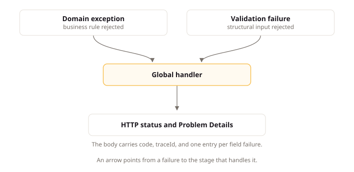

# HTTP API

**Stack:** any
**Concern:** web-api

The WebApi layer is the thin HTTP boundary of a LiteSpec backend. It converts each HTTP request into a message for the Application layer, dispatches it, and maps the result back to a stable HTTP response. Nothing else lives here: no business rules, no storage access, no provider calls.

That thinness keeps HTTP as replaceable transport, so the API evolves without touching business behavior. This page states what one endpoint owns, how routes, errors, and collection paging behave, and how the OpenAPI contract, the machine-readable description of the API, is generated from the code.

## Concepts

### Endpoints as Transport Adapters

An endpoint does three things and nothing else: it converts HTTP input to an Application message, dispatches that message through its mediator, and maps the result to the HTTP response. A mediator here means the Application-facing entry point for commands or queries.

One endpoint class serves one route operation and sits in its use case folder, and the host maps the endpoints the platform discovered in every module assembly the host adds.

Business rules, persistence access, provider calls, and error mapping all live outside endpoints: the handler owns behavior, the guard owns target authorization, and one global handler owns error responses.

Some endpoints belong to no use case, so they have no handler. The host keeps those: protocol endpoints, static assets, and development-only tooling, each carrying the mark naming the record it implements.

In Claimwick, the submit-expense endpoint reads the HTTP request, maps it to the submit command, dispatches it through the command mediator, and maps the result to the response. It checks no business rule and catches no failure.

### Errors as Problem Details

Every error response uses RFC 9457 Problem Details: a standard body carrying a stable application `code`, the current `traceId`, and one `errors` entry per field failure. The stable code lets a client branch on the failure without parsing prose, and the trace identifier connects the response to its diagnostics.

One global handler produces every error response. It maps every validation, domain, or use-case failure to its status and body. Because the mapping lives in one place, the same failure answers the same status and code from every endpoint.

In Claimwick, reimbursing an expense that is not approved answers 409 with the code `spending.not-approved`, whatever endpoint received the request. The endpoint catches nothing.

### The Generated Contract

The OpenAPI document is generated from the code during the Release build, with no handwritten copy. For each operation it declares a stable `operationId`, the client method name, with its authorization, request, success, and Problem Details metadata. The document declares a precise schema for every field.

Generation exists because a handwritten contract drifts from the code with the first unmirrored change. A generated contract derives from the code: change the endpoint and the contract follows. The generated artifact is committed when a frontend or external consumer reads it, so every contract change is visible in review and CI fails when the document was not regenerated.

Comments on handlers are not contract documentation: operations carry explicit summaries.

## Standards

### Map One Operation per Endpoint

**ID:** `litespec/backend/api#map-one-operation-per-endpoint`

**Strength:** required

**Applies to:** artifact: endpoint

**Statement:** An endpoint MUST map one route operation, convert input to an Application message, dispatch through its mediator, and map the result.

**Rationale:** When one endpoint class serves several operations, their input mappings, dispatches, and result mappings mix, and the class changes for unrelated routes. One endpoint class per route operation gives each route a single owner for all three.

**Example:** At startup, the application discovers endpoint implementations, registers each one once, and maps them in deterministic name order. Discovery uses the platform's own reflection and dependency injection. It needs no separate scanning package.

**Reviewed for:** Does every mapped route resolve to one endpoint type with one mediator dispatch? Look at the route table beside the use case folders.

### Keep Business Dependencies Out of Endpoints

**ID:** `litespec/backend/api#keep-business-dependencies-out-of-endpoints`

**Strength:** required

**Applies to:** artifact: endpoint

**Statement:** An endpoint MUST NOT take an aggregate repository, a persistence session or context, a provider client, or an application service.

**Rationale:** An endpoint that takes a repository, session, provider, or application service can reach business state or providers without passing the pipeline. Endpoints hold no request-scoped dependency because the application registers them at startup; they take only mediators and HTTP-boundary services such as an actor accessor. Handlers take neither mediators nor HTTP-boundary services, since a handler sends no message.

**Reviewed for:** Does any endpoint constructor take more than mediators and HTTP-boundary services? Look at the endpoint constructors in the use case folders.

### Defer Error Mapping to the Global Handler

**ID:** `litespec/backend/api#defer-error-mapping-to-the-global-handler`

**Strength:** required

**Applies to:** artifact: endpoint

**Statement:** An endpoint MUST NOT catch a use-case failure, a domain failure, or a validation failure.

**Rationale:** One global handler produces every error response from every failure type. When an endpoint catches a failure, it creates a second mapping for that failure, and the two mappings diverge: the same refusal answers different statuses or codes depending on which endpoint raised it.

**Reviewed for:** Does any endpoint body catch a use-case, domain, or validation failure? Look at the endpoint bodies beside the global handler.

### Apply Only Coarse Policies at the Endpoint

**ID:** `litespec/backend/api#apply-only-coarse-policies-at-the-endpoint`

**Strength:** required

**Applies to:** artifact: endpoint

**Statement:** A WebApi endpoint MUST enforce only coarse authenticated, role, or scope policies, leaving target decisions to the application guard.

**Rationale:** Authentication establishes who is calling, not whether the caller may act on this specific resource. An endpoint that decided target authorization would duplicate the business data access the guard already owns. Coarse policies at the endpoint check the caller; the application guard decides the target from the `access` the use-case record declares. `litespec/backend/application#enforce-target-authorization-in-the-pipeline` states target authorization.

An operation applies a stable forbidden or not-found policy when revealing that a resource exists would leak information.

**Reviewed for:** Does any endpoint policy decide target authorization instead of coarse authentication, role, or scope? Look at the endpoint policies beside the application guard.

### Return Stable Problem Details

**ID:** `litespec/backend/api#return-stable-problem-details`

**Strength:** required

**Applies to:** artifact: any

**Statement:** An error response MUST use [RFC 9457](https://datatracker.ietf.org/doc/html/rfc9457) Problem Details carrying a stable application `code`, the current `traceId`, and an `errors` entry for each field failure.

**Rationale:** A stable machine-readable code lets a client branch on the failure without parsing prose, and the trace identifier connects the response to its diagnostics. One entry per field failure tells the caller everything wrong with the request in one answer. RFC 9457 defines the Problem Details media type the contract uses.

**Example:** A validation failure returns this body:

```json
{
  "type": "https://example.test/problems/validation",
  "title": "Request validation failed",
  "status": 400,
  "detail": "One or more values are invalid.",
  "instance": "/api/posts",
  "code": "validation-failed",
  "traceId": "4bf92f3577b34da6a3ce929d0e0e4736",
  "errors": [
    {
      "field": "title",
      "code": "required",
      "message": "Title is required."
    }
  ]
}
```

`type` is a stable absolute URI owned by the consumer. `errors` appears only when validity findings exist, carrying their member, code, and message.

`code` carries the refusal result's stable code, and `detail` carries the free-form prose explanation. A request body names the same pair `code` and `reason` under `litespec/backend/api#name-failure-pairs-code-and-reason`.

WebApi maps Application member names to their public JSON field names. `traceId` carries the trace identifier from the current [W3C Trace Context](https://www.w3.org/TR/trace-context/) `traceparent`, with the request identifier as fallback. The same shape applies to authentication and authorization failures.

The global handler maps validation failures to 400 and missing targets through the operation's disclosure policy. It maps forbidden failures to 403 or the declared 404. The derived `invalid-input` refusal answers 400, and the derived `forbidden` refusal answers 403 or the declared 404. It maps conflicts and state rejections to 409, and unexpected failures to 500 with code `internal-error`. It maps each known domain failure individually. It does not report cancellation from a disconnected request as an application error.

In the Claimwick product, reimbursing an expense that is not approved ends with `result/reimburse-expense.not-approved`, which carries the code `spending.not-approved` and the status 409. For example, the global handler answers:

```json
{
  "type": "https://example.test/problems/conflict",
  "title": "Not approved",
  "status": 409,
  "detail": "The expense is not approved.",
  "instance": "/api/expenses",
  "code": "spending.not-approved",
  "traceId": "4bf92f3577b34da6a3ce929d0e0e4736"
}
```

The endpoint catches no failure. The diagram shows how a domain failure or a validation failure reaches the global handler and becomes a status with a Problem Details body.



**Reviewed for:** Does every error response carry the stable code, the traceId, and one errors entry per field failure? Look at the error responses at the API boundary.

### Use Consistent Status Codes

**ID:** `litespec/backend/api#use-consistent-status-codes`

**Strength:** required

**Applies to:** artifact: endpoint

**Statement:** A WebApi operation MUST return the status the outcome table assigns to its result.

**Rationale:** A client branches on status before it reads a body, so a status that disagrees with the outcome table hides the real outcome. The stack derives the status from the use-case result: each success and refusal kind maps to exactly one status, with no status recorded on the record, and the operation returns exactly that status.

**Example:**

| Outcome | Status |
|:---|:---:|
| Successful read | 200 |
| Successful creation of a readable resource | 201 with the resource location |
| Successful creation without a read route | 201 |
| Successful command without a response body | 204 |
| Structural validation failure | 400 |
| Missing or invalid authentication | 401 |
| Authenticated but forbidden | 403 |
| Resource unavailable under the disclosure policy | 404 |
| State, version, or idempotency conflict | 409 |
| Abuse limit exceeded | 429 with a `Retry-After` header |
| Accepted background operation | 202 with status location |
| Unexpected failure | 500 |

**Reviewed for:** Does every operation response return the status the outcome table assigns? Look at each response beside the outcome table.

### Bound Every File Upload

**ID:** `litespec/backend/api#bound-every-file-upload`

**Strength:** required

**Applies to:** artifact: endpoint; when: upload

**Statement:** A file upload operation MUST accept no file larger than the size its use-case record declares and no media type outside the media types its use-case record declares.

**Rationale:** An upload without a declared size or media-type bound lets one caller send work the server never agreed to store or inspect. Declaring both bounds on the use-case record lets the server refuse an oversize file or an undeclared type before storage, and lets a reviewer see the limit beside the use case that owns the file.

**Example:** The Claimwick submit-expense upload declares the size and the image media types a receipt photo may carry. The server refuses a larger file or another media type before it stores anything.

**Reviewed for:** Does every upload operation declare its size and media-type bounds, and refuse files outside them? Look at each upload endpoint beside its use-case record.

### Prove Every Upload Type from Its Content

**ID:** `litespec/backend/api#prove-every-upload-type-from-its-content`

**Strength:** required

**Applies to:** artifact: endpoint; when: upload

**Statement:** A file upload operation MUST determine the file type from the file content rather than the media type or file name the client claims.

**Rationale:** A claimed media type and a file name are caller input. Either one can name an image while the bytes carry anything else. Reading the type from the content itself enforces the declared media-type bound on what the server stores rather than on what the caller says it sent.

**Example:** A Claimwick receipt photo named as an image is stored as an image only when its bytes read as one of the declared image types. Bytes of another type are refused even when the name and claimed type agree.

**Reviewed for:** Does every upload operation read the file type from the bytes rather than the claimed media type or file name? Look at the type check of each upload endpoint beside the declared media types.

### Store Every Upload Through Infrastructure

**ID:** `litespec/backend/api#store-every-upload-through-infrastructure`

**Strength:** required

**Applies to:** artifact: command-handler, endpoint; when: upload

**Statement:** File storage for an upload MUST live in Infrastructure.

**Rationale:** Storing a file is provider work, like storing an aggregate, so the endpoint stays a transport adapter and the handler stays on behavior. Infrastructure owns the storage provider, its configuration, and its errors, so a project can change where files live without touching an endpoint or a handler.

**Example:** The Claimwick endpoint for a receipt photo converts the request to its command and dispatches it, the handler stages the expense, and Infrastructure writes the photo bytes to the configured store.

**Reviewed for:** Does any endpoint or handler write file bytes to a storage provider directly? Look at the upload endpoints and handlers beside the Infrastructure storage code.

### Authorize Every File Download Through Its Owning Use Case

**ID:** `litespec/backend/api#authorize-every-file-download-through-its-owning-use-case`

**Strength:** required

**Applies to:** artifact: endpoint; when: upload

**Statement:** A caller MUST reach a stored file only through a download use case authorized from the access that use case declares.

**Rationale:** A stored file carries the data of the record it belongs to. A direct storage address would serve that data to anyone holding the address, skipping the owning use case's grant and tenant scope. Routing each download through its owning use case keeps one authorization decision for the file and for the record it belongs to.

**Example:** A Claimwick receipt photo downloads through the use case that owns the expense, so only an actor its access allows reads the photo, and no storage address serves it on its own.

**Reviewed for:** Is every stored file reachable only through a download use case with its declared access? Look at the download endpoints and the storage addresses beside each owning use case.

### Require the Marker Header on Cookie-Authenticated Writes

**ID:** `litespec/backend/api#require-the-marker-header-on-cookie-authenticated-writes`

**Strength:** required

**Applies to:** artifact: any

**Statement:** The API MUST refuse a cookie-authenticated write without the project's marker header.

**Rationale:** Cookies travel with every request, including ones a malicious page triggers, so a cookie-authenticated write needs proof the project's own page sent it. A page on another site adds no custom header, so the header's absence exposes a cross-site forgery. A write is any request other than GET, HEAD, or OPTIONS. The header takes the form `X-<Project>-Request: 1`, with the exact name set in project configuration.

The refused request is unauthenticated, so it answers 401 under `litespec/backend/api#use-consistent-status-codes`. The frontend pages state when the header is sent; this provision states when the API refuses a request without it.

**Reviewed for:** Does every cookie-authenticated write without the marker header answer 401? Look at the write requests with cookie authentication.

### Keep Routes Resource-Oriented

**ID:** `litespec/backend/api#keep-routes-resource-oriented`

**Strength:** required

**Applies to:** artifact: endpoint

**Statement:** A route MUST use lowercase plural resource segments, kebab-case subresources, route parameters for identity, query parameters for filtering, and the body for command data.

**Rationale:** A predictable route shape lets a caller derive an unfamiliar operation from a familiar one: plural resource segments, kebab-case subresources, route parameters for identity, query parameters for filtering, and command data in the body. A route that encoded actions or identities anywhere else would force the caller to read each route's documentation. For a transition beyond the five verbs, [AIP-136](https://google.aip.dev/136) defines the custom-method form.

**Example:** A route carries the authenticated actor identifier only when that actor is intentionally addressing another actor as a resource.

**Reviewed for:** Does every route use plural segments, kebab-case subresources, identity parameters, filter queries, and body command data? Look at the route table entries.

### Apply PATCH to a Partial Update

**ID:** `litespec/backend/api#apply-patch-to-a-partial-update`

**Strength:** required

**Applies to:** artifact: endpoint; when: command

**Statement:** A WebApi operation MUST apply a partial update with PATCH and the `application/merge-patch+json` media type.

**Rationale:** A partial update names only the fields it changes. Sending them with PATCH and the merge-patch media type gives those semantics a standard meaning. A PUT body for a partial change either repeats fields the caller does not change or invents merge semantics per field. [RFC 5789](https://datatracker.ietf.org/doc/html/rfc5789) defines PATCH and [RFC 7386](https://datatracker.ietf.org/doc/html/rfc7386) defines the merge-patch media type.

**Example:** A partial update sends only the changed members with `Content-Type: application/merge-patch+json`, and the endpoint reads the body as a sparse patch. A PUT replaces the whole resource ([RFC 9110 section 9.3.4](https://datatracker.ietf.org/doc/html/rfc9110#section-9.3.4)), and DELETE remains a hard-state transition.

**Reviewed for:** Does every partial update arrive as PATCH with the merge-patch media type? Look at the partial update requests.

### Bound Collection Queries

**ID:** `litespec/backend/api#bound-collection-queries`

**Strength:** required

**Applies to:** artifact: endpoint; when: query

**Statement:** A collection endpoint MUST apply deterministic ordering, its record's declared default limit, and its record's declared maximum limit of 100 or lower.

**Rationale:** An unbounded collection read lets one caller cause unbounded database and serialization work. Deterministic ordering keeps pages stable, the declared default limit bounds the common case, and the declared maximum of 100 or lower caps the worst case. The use-case record declares its paging with order, cursor or offset, default limit, and maximum limit, and the endpoint applies exactly that. `litespec/backend/api#use-opaque-cursors-for-collection-paging` and `litespec/backend/api#version-cursors-with-stable-sort-values` state the cursor mechanics.

**Example:** A request uses `after` as an opaque cursor and `limit` as a positive integer. The implementation fetches one record beyond the requested limit to determine whether another page exists. The response uses one shape:

```json
{
  "items": [],
  "page": {
    "limit": 20,
    "nextCursor": null,
    "hasMore": false
  }
}
```

**Reviewed for:** Does every collection response apply deterministic order with the declared default and maximum limits? Look at the collection responses beside their records.

### Use Opaque Cursors for Collection Paging

**ID:** `litespec/backend/api#use-opaque-cursors-for-collection-paging`

**Strength:** required

**Applies to:** artifact: endpoint; when: query

**Statement:** A collection endpoint MUST page with an opaque cursor and refuse a malformed cursor with 400 and code `invalid-cursor`.

**Rationale:** A cursor that exposed offsets or internals lets callers craft requests against storage details, and breaks every stored cursor when those details change. An opaque cursor keeps paging state server-defined. The endpoint treats it as untrusted input: a malformed cursor, or an unsupported cursor version, answers 400 with code `invalid-cursor`.

**Reviewed for:** Does every malformed cursor answer 400 with code invalid-cursor? Look at the collection endpoints.

### Version Cursors with Stable Sort Values

**ID:** `litespec/backend/api#version-cursors-with-stable-sort-values`

**Strength:** required

**Applies to:** artifact: endpoint; when: query

**Statement:** A paging cursor MUST carry a version and the last stable sort values, including a unique tie-breaker, and no sensitive value in readable form.

**Rationale:** Paging reads a sorted sequence in order, so the cursor names exactly where the last page stopped. The version lets the sort evolve without breaking stored cursors, and the last stable sort values with a unique tie-breaker keep the read exact when values repeat. The tie-breaker matches the query's stable order under `litespec/backend/api#bound-collection-queries`. No sensitive value travels in readable form, because callers store and replay cursors.

**Reviewed for:** Does every cursor payload carry a version, the last sort values, and a unique tie-breaker, with no readable secret? Look at the cursor payloads.

### Treat OpenAPI as a Generated Contract

**ID:** `litespec/backend/api#treat-openapi-as-a-generated-contract`

**Strength:** required

**Applies to:** artifact: any

**Statement:** An application MUST generate its OpenAPI document during the Release build.

**Rationale:** A handwritten contract drifts from the code it describes with the first unmirrored change. Generating the document during the Release build derives the contract from the code, so the file the pinned generator reads stays current.

**Example:** The API source artifact is `apps/api/openapi/{ProjectName}.json`.

Build-time generation boots the host, which runs every startup guard. A project whose composition refuses to start without a secret, a certificate, or a reachable dependency generates no contract from a clean checkout. Two answers are valid, and the project records which one it uses under `litespec/backend/api#generate-the-contract-without-hosted-dependencies`.

| Answer | What the project does | What it costs |
|:---|:---|:---|
| Generation environment | Set an environment for the generation run whose composition wires no hosted dependency. | The generated document reflects that environment's endpoint set. |
| Deferred guard | Move each startup refusal from composition to first use. | A misconfiguration surfaces on the first request instead of at boot. |

Generation without hosted dependencies follows `litespec/backend/api#generate-the-contract-without-hosted-dependencies`.

When a typed consumer reads the API, the pinned generator reads the source artifact. The generated client, model types, request schemas, and query options form one workspace package, because every frontend and every command reads them.

**Reviewed for:** Does every Release build regenerate the OpenAPI artifact, with no contract gate passing on a changed tree? Look at the Release build output and the contract gate.

### Declare Stable Operation Metadata in the Contract

**ID:** `litespec/backend/api#declare-stable-operation-metadata-in-the-contract`

**Strength:** required

**Applies to:** artifact: endpoint

**Statement:** An operation MUST declare a stable `operationId`, its authorization, request, success, and Problem Details metadata, and a summary.

**Rationale:** Generated clients name their methods from `operationId`. An unstable name renames client code on every generation. Authorization metadata cites the enforced policies and Problem Details metadata covers every documented failure status, so the client models security and failure before its first call. Comments on handlers are not contract documentation, so operations carry explicit summaries.

**Reviewed for:** Does every operation in the generated contract declare its operationId, authorization, request, success, failure, and summary entries? Look at the operations in the generated contract.

### Name the Use Case on Every Published Operation

**ID:** `litespec/backend/api#name-the-use-case-on-every-published-operation`

**Strength:** required

**Applies to:** artifact: endpoint

**Statement:** Every operation in the generated contract MUST carry `x-litespec-use-case` naming the use case its endpoint implements.

**Rationale:** The `operationId` names an operation for client code, cased for method names, so it is not the record identifier. Carrying the identifier itself in an extension, which the OpenAPI specification reserves for this kind of metadata, lets an integrator, a gateway log, or a support person go from an operation straight to its specification page. The value comes from the generated map of operation names to use cases, so it is written once, in the endpoint's mark.

**Example:** The Claimwick operation `SubmitExpense` carries `"x-litespec-use-case": "use-case/spending.submit-expense"`.

**Checked by:** `litespec model check` reports `operation-use-case-drift` (level S) for an operation in the committed contract whose `x-litespec-use-case` is missing or differs from the use case its endpoint's mark names.

### Commit the Generated Contract Its Consumers Read

**ID:** `litespec/backend/api#commit-the-generated-contract-its-consumers-read`

**Strength:** required

**Applies to:** artifact: any

**Statement:** An application MUST commit its generated OpenAPI artifact when a frontend or external consumer reads it.

**Rationale:** Without a committed file, a breaking contract change hides inside a code change. A committed artifact makes every contract change visible in review and lets CI fail when the document was not regenerated. Consumers read the artifact through the generated client, model, schema, and query-option packages.

**Reviewed for:** Does every frontend or external consumer read a committed, current OpenAPI artifact? Look at the committed artifact beside its consumers.

### Reflect Enforced Authentication in the Contract

**ID:** `litespec/backend/api#reflect-enforced-authentication-in-the-contract`

**Strength:** required

**Applies to:** artifact: any

**Statement:** A generated OpenAPI document MUST declare the security scheme and per-operation security requirement for every endpoint that enforces authentication.

**Rationale:** A consumer that learns an authentication requirement from a runtime 401 has already built the wrong client. Declared security schemes and per-operation requirements let it build the right one before its first call. Handwritten security metadata drifts from registered schemes, so the document derives them from the registered authentication schemes.

**Example:** The implementation reads the registered authentication schemes and adds the matching `securitySchemes` and `security` entries. An operation whose `access` grant is `anonymous` declares no security requirement.

**Reviewed for:** Does every authenticated operation declare its security schemes and requirements in the generated contract? Look at the operations in the generated contract.

### Publish Precise, Complete Schemas

**ID:** `litespec/backend/api#publish-precise-complete-schemas`

**Strength:** required

**Applies to:** artifact: endpoint

**Statement:** A generated schema MUST declare the closed value set, bounds, format, and required control headers of each field and parameter it describes.

**Rationale:** A caller that learns limits from the document validates before sending. A caller that learns them from runtime rejections discovers one limit per failed request. Declaring the closed value set, bounds, format, and required control headers of each field and parameter moves every checkable limit into the contract.

**Example:** A label-only set publishes its values as an OpenAPI `enum`. A data-bearing set publishes a polymorphic `oneOf` model with a discriminator per `litespec/backend/api#mirror-each-closed-set-on-the-wire`. A converter on the boundary type keeps every serializer producing the contracted shape, including a test client using default options. Host-only conversion breaks readers that do not share host configuration.

An operation requiring a control header declares it as a required parameter, for example `Idempotency-Key` or `If-Match`. The implementation prefers results, enums, and parameter metadata derived from code over handwritten schemas that drift from code.

**Reviewed for:** Does every contract schema declare the value sets, bounds, formats, and required control headers of its fields? Look at the schemas in the generated contract.

### Expose Development Tooling in Development Only

**ID:** `litespec/backend/api#expose-development-tooling-in-development-only`

**Strength:** required

**Applies to:** artifact: any

**Statement:** An application MUST map its API exploration and diagnostic endpoints only when the host runs in the Development environment.

**Rationale:** Development tooling exposes the full API surface for exploration. That suits development; a hosted environment offers only the API. Mapping the tooling in Development only keeps exploration local.

**Reviewed for:** Does any hosted environment serve exploration tooling, and does every Development host map it? Look at the mapped endpoints in each environment.

### Mirror Each Closed Set on the Wire

**ID:** `litespec/backend/api#mirror-each-closed-set-on-the-wire`

**Strength:** required

**Applies to:** artifact: endpoint

**Statement:** A WebApi transport model for a Domain closed set MUST preserve the shape of that set.

**Rationale:** Each case of a closed set can carry different data. A transport shape that differs from its Domain set discards information the Domain carries. Preserving the shape keeps every case and its data on the wire. Label-only sets follow `litespec/backend/api#publish-label-only-sets-as-string-enums`, and data-bearing sets follow `litespec/backend/api#mark-polymorphic-models-with-discriminators`. Narrowing follows `litespec/backend/application#record-a-decision-for-closed-set-narrowing`.

**Example:** A label-only set maps to a string `enum`. A data-bearing set maps to a polymorphic model with one case per variant, published as `oneOf` with a discriminator.

**Reviewed for:** Does every transport model preserve the cases and data of its Domain set? Look at each transport model beside its Domain set.

### Publish Label-Only Sets as String Enums

**ID:** `litespec/backend/api#publish-label-only-sets-as-string-enums`

**Strength:** required

**Applies to:** artifact: endpoint

**Statement:** A transport model for a label-only set MUST publish its values as an OpenAPI string `enum`.

**Rationale:** A label-only set carries no case data, so its labels are the complete contract, and a string enum carries them exactly. `litespec/backend/domain#model-every-closed-set-as-a-type-hierarchy` states the permission to use a plain enum in this one situation.

**Reviewed for:** Does every label-only set publish its string enum in the contract? Look at the label-only sets in the contract.

### Mark Polymorphic Models with Discriminators

**ID:** `litespec/backend/api#mark-polymorphic-models-with-discriminators`

**Strength:** required

**Applies to:** artifact: endpoint

**Statement:** A data-bearing set MUST map to a polymorphic model with one case per variant, published as `oneOf` with a string discriminator.

**Rationale:** A polymorphic payload without a discriminator forces the reader to guess the case from its fields. A required string discriminator names the case on every payload, so no payload validates without one. The strings equal the Domain union's stable case codes and stay stable across identifier renames.

**Example:**

- Declare one polymorphic base with one registered case per variant.
- Carry the metadata on the type, not only in host options.
- Name the discriminator property, using a name such as `type` or `outcome`.
- Opt cases in explicitly, so an unregistered subtype fails serialization.
- Complete discriminator metadata that the generator omits with a document or schema transformer.

**Reviewed for:** Does every data-bearing set publish a oneOf model with a required string discriminator? Look at the data-bearing sets in the contract.

### Reject a Collapsed or Borrowed Wire Contract

**ID:** `litespec/backend/api#reject-a-collapsed-or-borrowed-wire-contract`

**Strength:** required

**Applies to:** artifact: endpoint

**Statement:** A WebApi transport model MUST NOT collapse a data-bearing set into an `enum` or reuse a Domain or Application type as the wire contract.

**Rationale:** Collapsing a data-bearing set into an enum discards the data that distinguishes its cases. Reusing a Domain or Application type as the wire contract couples the public contract to inner shapes. Each layer owns its own contract type per `litespec/backend/architecture#own-each-layers-contract-types`, so the wire contract is always a dedicated transport model. Narrowing follows `litespec/backend/application#record-a-decision-for-closed-set-narrowing`.

**Reviewed for:** Does any wire contract collapse a data-bearing set into an enum or reuse a Domain or Application type? Look at each wire contract.

### Keep One Name for a Use Case Across Layers

**ID:** `litespec/backend/api#keep-one-name-for-a-use-case-across-layers`

**Strength:** required

**Applies to:** artifact: endpoint, use-case

**Statement:** Each use case MUST carry its name unchanged in its message type, operation id, and audit action.

**Rationale:** A use case that reads one way in its record, another in its message type, and a third in its audit action forces every trace across layers through a translation table only the author holds. The record id is the name; the message type, the endpoint operation id, and the audit action repeat it in their own casing, so a reader follows one name from the page to the wire to the audit log.

**Example:** `use-case/spending.reimburse-expense` travels as `ReimburseExpenseCommand`, operation id `ReimburseExpense`, and audit action `reimburse-expense`; an operation id of `PayExpense` is reported.

**Reviewed for:** Does every message type, operation id, and audit action carry its use case name? Look at each use case's message type, operation id, and audit action.

## Conventions

### Use This Endpoint Layout

**ID:** `litespec/backend/api#use-this-endpoint-layout`

**Strength:** default

**Applies to:** artifact: endpoint

**Default:** Place each endpoint with its request and response models in the `WebApi/{UseCase}/` folder of its use case, and host-only endpoints in the host.

**Replacement:** A project names its endpoint layout in its backend documentation.

**Rationale:** When each endpoint sits in the `WebApi/{UseCase}/` folder of its use case, the folder path matches the specification path, and a reader locates an operation from its use-case identifier without searching. Each use case owns its transport models, so a shape two use cases need is declared in each under `litespec/backend/architecture#give-each-use-case-its-own-models`. The host keeps the endpoints that belong to no use case: protocol endpoints, static assets, and development-only tooling.

**Example:** The endpoints sit in the `WebApi/{UseCase}/` folder of their use case inside the `WebApi/` folder of their module:

```text
{Product}/
  Posts/                            single aggregate whose name matches the module
    Application/
      CreateDraft/                  message, result, handler, validator
      GetPost/
    WebApi/
      CreateDraft/                  endpoint, request model, response model
      GetPost/
  Customers/                        two aggregates: each layer holds one folder per use case it serves
    Application/
      RestrictAccount/
      GrantConsent/
    WebApi/
      RestrictAccount/
      GrantConsent/
```

Module nesting follows `litespec/backend/architecture#organize-code-by-module-aggregate-and-use-case`.

**Reviewed for:** Does every endpoint sit in the `WebApi/` folder of its use case or in the host? Look at the endpoints beside the use case folders.

### Name Transport Types by Their Boundary Role

**ID:** `litespec/backend/api#name-transport-types-by-their-boundary-role`

**Strength:** default

**Applies to:** artifact: endpoint

**Default:** Transport types take the names the suffix table assigns their roles.

**Replacement:** A project names its transport suffixes in its backend documentation.

**Rationale:** A name that ends in its boundary role keeps transport concerns visibly separate from Application messages and results. `litespec/workspace/naming#use-architectural-suffixes` states the suffix table that assigns each role its suffix.

**Example:** A passive HTTP DTO names its boundary role and ends in `Model`.

**Reviewed for:** Does every transport type name carry the suffix its boundary role assigns? Look at the transport type names.

### Name Routes from Resources

**ID:** `litespec/backend/api#name-routes-from-resources`

**Strength:** default

**Applies to:** artifact: endpoint

**Default:** Derive each route from its resource and subresource, and use an action segment only when the operation maps to neither.

**Replacement:** A project names its route shape in its backend documentation.

**Rationale:** A route derived from its resource reads the same for every operation: the caller knows the record before opening the handler. An action segment reserved for operations that map to neither resource nor subresource keeps the exception visible instead of spreading verb-led routes.

**Example:**

```text
POST   /api/posts
GET    /api/posts/{postId}
GET    /api/posts/{postId}/publication
GET    /api/posts?after={cursor}&limit=20
```

**Reviewed for:** Does every route derive from its resource and subresource, with an action segment only where neither fits? Look at the route table.

### Shape Command Routes from the Aggregate and the Verb

**ID:** `litespec/backend/api#shape-command-routes-from-the-aggregate-and-the-verb`

**Strength:** default

**Applies to:** artifact: endpoint; when: command

**Default:** A command route carries the aggregate plural, and a custom action ends with the use-case verb as its last segment; a POST to the collection, a PUT, PATCH or DELETE on one resource, and a verb the HTTP method already says (POST for create, add and register; PUT or PATCH for change; DELETE for remove) keep the plain resource route.

**Replacement:** A project names its route shape in its backend documentation.

**Rationale:** A route that names the aggregate plural, its identity, and the verb as the last segment reads the same for every command: the reader knows the record and the act before opening the handler. A route that repeats the noun or hides the verb forces the reader to learn each command route separately.

**Example:**

```text
POST   /api/expenses/{id}/reimburse
POST   /api/holds/{holdId}/cancel
```

**Reviewed for:** Does every command route carry the aggregate plural and end with its verb? Look at the command routes.

### Keep Numeric Transport Types Precise

**ID:** `litespec/backend/api#keep-numeric-transport-types-precise`

**Strength:** default

**Applies to:** artifact: endpoint

**Default:** Emit a plain numeric schema for an `int32` or `double` field, and reserve a string-or-number union for `int64` values beyond the JSON safe integer range.

**Replacement:** A project names its numeric wire shapes in its backend documentation.

**Rationale:** A plain numeric schema lets consumers read `int32` and `double` directly. A string-or-number union is reserved for `int64` values beyond the JSON safe integer range, because an over-broad union forces every consumer to coerce plain numbers.

**Reviewed for:** Does every numeric field publish a plain schema, with the int64 union reserved for values beyond the safe range? Look at the numeric fields in the contract.

### Model a Monetary Value as One Object

**ID:** `litespec/backend/api#model-a-monetary-value-as-one-object`

**Strength:** default

**Applies to:** artifact: endpoint

**Default:** Carry a monetary value as one `Money` object in a response model and in a request where the caller chooses the currency, with `amount` as an invariant decimal string and `currency` as an ISO 4217 code.

**Replacement:** A project names its money wire shape in its backend documentation.

**Rationale:** Split sibling fields pair only by a server invariant invisible to the schema, so a report reads the two independently and mismatches them. One `Money` object holding `amount` and an ISO 4217 `currency` mirrors the Domain shape on the wire under `litespec/backend/domain#model-money-with-exact-decimal-values`. The amount travels as a string, never a JSON number, so no reader parses it as binary floating point. A caller with no currency choice carries `amount` alone, because a fixed currency arrives from the account, not the caller.

**Example:** `unitPrice` and `currencyCode` become `price` of type `Money`, traveling as `{ "amount": "12.50", "currency": "EUR" }`. A request that references an account with a fixed currency carries `amount` alone.

**Reviewed for:** Does every monetary value travel as one Money object with a string amount, with currency only where the caller chooses it? Look at the monetary fields in the contract.

### Name Boolean Fields as Conditions

**ID:** `litespec/backend/api#name-boolean-fields-as-conditions`

**Strength:** default

**Applies to:** artifact: endpoint

**Default:** Boolean fields use the same condition names as code, in camel case.

**Replacement:** A project names its boolean wire shape in its backend documentation.

**Rationale:** Condition names state what the boolean means, and the camel-case form matches wire conventions. `litespec/workspace/naming#use-intent-revealing-boolean-names` states the boolean names, and transport carries the camel-case form.

**Example:** `IsBuyable` in code becomes `isBuyable` on the wire.

**Reviewed for:** Does every boolean field use the camel-case condition name of its code name? Look at the boolean fields in the contract.

### Name Time Fields with At

**ID:** `litespec/backend/api#name-time-fields-with-at`

**Strength:** default

**Applies to:** artifact: endpoint

**Default:** Time fields end in `At`, following [AIP-142](https://google.aip.dev/142).

**Replacement:** A project names its time field shape in its backend documentation.

**Rationale:** A mixed suffix set hides which shape each field carries. One `At` suffix tells the reader every time field carries a timestamp.

**Example:** `createdAt` names the creation time.

**Reviewed for:** Does every time field in contract schemas end in At? Look at the time fields.

### Use Standard Field Vocabulary

**ID:** `litespec/backend/api#use-standard-field-vocabulary`

**Strength:** default

**Applies to:** artifact: endpoint

**Default:** Field names use `created` over `placed`, `languageTag` over `locale`, and `displayName` over `keyName`.

**Replacement:** A project names its field vocabulary in its backend documentation.

**Rationale:** Shared vocabulary stops the same field from appearing under different names on different operations. `languageTag` follows [RFC 5646](https://datatracker.ietf.org/doc/html/rfc5646).

**Example:** `defaultLanguageTag` replaces `defaultLocaleTag`.

**Reviewed for:** Does any field use placed, locale, or keyName over the standard vocabulary? Look at the field names in the contract.

### Name Failure Pairs Code and Reason

**ID:** `litespec/backend/api#name-failure-pairs-code-and-reason`

**Strength:** default

**Applies to:** artifact: endpoint

**Default:** A request body names a failure with `code` for the class and `reason` for the explanation.

**Replacement:** A project names its failure pair shape in its backend documentation.

**Rationale:** A request body names failures the same way responses do: `code` for the class, `reason` for the explanation, mirroring the Problem Details code and detail under `litespec/backend/api#return-stable-problem-details`. One pair in both directions lets clients reuse their failure handling.

**Reviewed for:** Does every request body name failures with code and reason? Look at the failure pairs in request bodies.

### Name Path Parameters per Resource

**ID:** `litespec/backend/api#name-path-parameters-per-resource`

**Strength:** default

**Applies to:** artifact: endpoint

**Default:** Each path parameter names its own resource identity, and a `details` segment takes the aggregate name.

**Replacement:** A project names its path parameter shape in its backend documentation.

**Rationale:** Each path parameter names its own resource identity, so `/api/posts/{postId}` is mistaken for no other resource's key. A shared `id` hides which resource it identifies.

**Example:** `/api/posts/{postId}` names the post; `/details` takes the aggregate name.

**Reviewed for:** Does every path parameter name its own resource identity? Look at the path parameters.

### Avoid Noise Words in Field Names

**ID:** `litespec/backend/api#avoid-noise-words-in-field-names`

**Strength:** default

**Applies to:** artifact: endpoint

**Default:** Field names carry no type prefix and no noise word.

**Replacement:** A project names its field name rules in its backend documentation.

**Rationale:** A type prefix repeats what the schema already declares, and a noise word names nothing an integrator acts on: `customerInfo` carries no more meaning than `customer`. The noise words are `data`, `info`, `item`, `object`, `value`, and `thing`; the type prefixes are `str`, `int`, `bool`, `num`, `obj`, and `arr`.

**Example:** `customerInfo` becomes `customer`.

**Reviewed for:** Does any field name in contract schemas carry a type prefix or noise word? Look at the field names.

### Declare a Smaller Collection Maximum

**ID:** `litespec/backend/api#declare-a-smaller-collection-maximum`

**Strength:** default

**Applies to:** artifact: record:use-case; when: query

**Default:** A use case with stricter needs declares its smaller maximum in its record's `paging` and states the reason on its use-case record.

**Replacement:** A project names its collection limit shape in its backend documentation.

**Rationale:** Some collections cost more per item than others. A use case with stricter needs declares its smaller maximum in its record's `paging` with the reason on its use-case record, and the endpoint enforces it under `litespec/backend/api#bound-collection-queries`.

**Reviewed for:** Does every lowered collection maximum carry its value and reason on the use-case record? Look at each lowered maximum.

### Use Offsets for Proven Bounded Datasets

**ID:** `litespec/backend/api#use-offsets-for-proven-bounded-datasets`

**Strength:** default

**Applies to:** artifact: record:use-case; when: query

**Default:** A collection over a proven bounded dataset declares offset paging in its record while the public contract stays cursor-shaped.

**Replacement:** A project names its paging shape in its backend documentation.

**Rationale:** Offsets skip rows the database still scans, so they stay cheap only while the dataset stays small. A collection over a proven bounded dataset declares offset paging while the public contract stays cursor-shaped, and the use-case record states the bound that makes it safe.

**Reviewed for:** Does every offset-paged collection state the bound making it safe on the use-case record? Look at each offset-paged collection.

### Generate the Contract Without Hosted Dependencies

**ID:** `litespec/backend/api#generate-the-contract-without-hosted-dependencies`

**Strength:** default

**Applies to:** artifact: any

**Default:** The generation run contacts no hosted dependency and runs no schema change, and the project records its chosen answer.

**Replacement:** A project names its generation setup in its backend documentation.

**Rationale:** Build-time generation boots the host, and a boot that needs a secret, a certificate, or a reachable dependency fails on a clean checkout. The project records which answer it uses: a generation environment that wires no hosted dependency for the generation run, or a deferred guard that moves each startup refusal from composition to first use. The document reflects the generation environment's endpoint set, and with a deferred guard a misconfiguration surfaces on the first request instead of at boot.

**Reviewed for:** Does every generation run avoid hosted dependencies with a recorded answer? Look at the generation runs beside the project record.

## Reference Example

This informative example demonstrates `litespec/backend/api#keep-business-dependencies-out-of-endpoints` and `litespec/backend/api#mirror-each-closed-set-on-the-wire`.

A create endpoint reads the author from claims, maps the request model to the command through the endpoint mappings, sends the command through the command mediator, and maps the result to the response model with the new resource location. A read endpoint maps the query result through its own mappings. No endpoint calls the aggregate factory or the Domain repository.

A refund outcome is a closed set whose cases carry different data. Domain models it once. Application mirrors it per `litespec/backend/application#mirror-a-domain-closed-set-in-the-result`, and WebApi mirrors it again as a polymorphic transport model rather than serializing either inner type.
