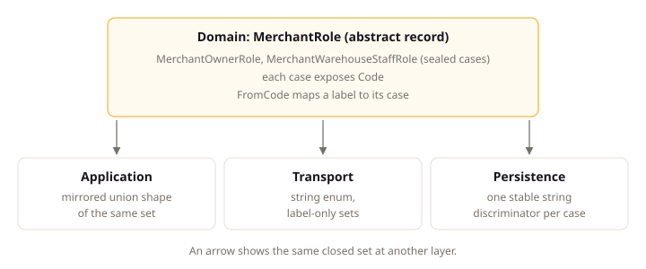

# .NET Domain Layer

**Stack:** dotnet
**Concern:** domain

Domain folders contain the business model of a .NET backend in C# types that reference only the .NET base class library and product-owned Domain types.

This page defines the C# forms for those types: aggregates, lifecycles, identities, child entities, value objects, closed sets, money, repositories, events, and the exceptions that reject broken rules. Each provision cites the shared rule it implements from [Domain Layer](../domain.md).

## Concepts

### Aggregates and State Records

An aggregate is one unit of business state that stays consistent and changes in one step. Its root is the single type through which outside code changes it. Every aggregate exposes its lifecycle through one `State` property.

The `State` property is backed by an abstract state record with one sealed record per state. Each state record carries that state's own data, such as the publication time of a published post. The aggregate's methods own the transitions between states.

In Claimwick, an expense moves from submitted to approved when `Approve` runs. The method accepts only a submitted expense, stores an approved state carrying the approver and the decided time, and raises the approval event.

Child entities and value objects are design choices inside an aggregate: they appear in code and the glossary, never as records. A `store` aggregate is the exception. It has no root, state record, or repository in Domain, and reaches code through a port.

### Closed Sets Without Enums

A closed set is a fixed group of values, such as refund outcomes or merchant roles. Domain models each one as an abstract record with one sealed case record per value. Each case exposes a stable string `Code`.

An enum cannot carry case data and admits undefined values through a cast, so no enum appears in Domain. A record hierarchy carries each case's data in its own sealed record instead.

Sets whose cases carry no data convert labels back through `FromCode`. The merchant roles map `owner` and `warehouse-staff` to their cases and reject anything else as unsupported.

The record hierarchy is the Domain form. The same set appears mirrored in Application results, as a polymorphic transport model or a label-only string enum, and as one string discriminator per case in persistence.

### Identities, Money, and Repositories

Each aggregate identity is a small struct over one version 7 `Guid`, created by the caller and passed in. The struct rejects empty values.

Money is one shared value object with a decimal amount and an ISO 4217 currency code.

Each aggregate root gets one repository interface that loads and stages that aggregate only. The interface stages the aggregate. The command pipeline owns the commit.

## Standards

### Keep Domain Free of Outer-Layer Concerns

**ID:** `litespec/backend/dotnet/domain#keep-domain-free-of-outer-layer-concerns`

**Strength:** required

**Applies to:** artifact: any

**Statement:** Domain code MUST reference only the .NET base class library and product-owned Domain types.

**Rationale:** Once Domain names a persistence or web type, business rules depend on the framework instead of the framework depending on them. Keeping Domain to the base class library and product-owned types means a provider change cannot reach business behavior. Infrastructure registers persisted discriminators and mappings, so Domain carries no serialization attribute. This provision binds `litespec/backend/domain#keep-domain-independent-of-outer-layers` for .NET.

**Checked by:** `dotnet build` reports `LS1001` for Domain code naming an outer-layer type.

### Use the Project Aggregate Root Contract

**ID:** `litespec/backend/dotnet/domain#use-the-project-aggregate-root-contract`

**Strength:** required

**Applies to:** artifact: aggregate

**Statement:** An aggregate root MUST be a sealed class deriving from the project-owned `AggregateRoot<TId>`, taking identity and event mechanics from that base.

**Rationale:** One project-owned base gives every aggregate the same mechanics: typed identity, a pending event collection with protected recording, and clearing. The shared base supplies exactly those mechanics and nothing else: no timestamps, audit, tenancy, lifecycle, or persistence that would force every aggregate to carry behavior most never need. It carries the aggregate version only as persistence metadata, which Domain never reads or sets. The root stays a sealed class, so no behavior extends an aggregate by inheritance. It carries a mark naming its aggregate record for the builder to link. This provision binds `litespec/backend/domain#take-identity-and-events-from-the-shared-root-contract` for .NET.

**Reviewed for:** Does every aggregate root stay a sealed class derived from the project-owned `AggregateRoot<TId>`? Check each root declaration.

### Mark Each State-Changing Root Method with Its Use Case

**ID:** `litespec/backend/dotnet/domain#mark-each-state-changing-root-method-with-its-use-case`

**Strength:** required

**Applies to:** artifact: aggregate

**Statement:** A root method that changes state MUST carry exactly one `<implements>` mark naming its use case.

**Rationale:** The `<implements>` mark is the XML documentation tag that ties a method to the use case whose act it performs. The builder and the analyzer read the same link from it. A reading or private method performs no act and carries no use-case mark. `LS5002` reports one that does. This provision binds `litespec/backend/domain#give-each-use-case-its-own-act` for .NET. The model check for the same rule stays on that generic provision.

**Example:**

```csharp
/// <implements>use-case/spending.approve-expense</implements>
public void Approve(ApproverId approverId, DateTimeOffset decidedAt)
{
    if (State is not ExpenseSubmittedState)
    {
        throw new ExpenseNotSubmittedException(Id);
    }

    State = new ExpenseApprovedState(approverId, decidedAt);
    RaiseDomainEvent(new ExpenseApprovedEvent(Id, approverId, decidedAt));
}
```

**Checked by:** `dotnet build` reports `LS5003` for a root method carrying other than one use-case mark, and `LS5002` for a mark on a reading or private method.

### Model Child Entities as Sealed Classes

**ID:** `litespec/backend/dotnet/domain#model-child-entities-as-sealed-classes`

**Strength:** required

**Applies to:** artifact: aggregate, value-object

**Statement:** A child entity MUST be a sealed class deriving from the project-owned `Entity<TId>`.

**Rationale:** Deriving from the project-owned `Entity<TId>` gives the child typed identity and identity equality, so it declares only its own data and behavior. The root creates, finds, and changes its children through business methods. A child exposes no mutable state outside the root. A child is a design choice inside its aggregate: it appears in code and the glossary, never as a record. This provision binds `litespec/backend/domain#keep-child-entities-inside-the-aggregate-boundary` for .NET.

**Example:**

```csharp
public sealed class OrderLine : Entity<OrderLineId>
{
    internal OrderLine(OrderLineId id, ProductId product, int quantity, Money price)
        : base(id)
    {
        Product = product;
        Quantity = quantity;
        Price = price;
    }

    public ProductId Product { get; }

    public int Quantity { get; private set; }

    public Money Price { get; }

    internal void ChangeQuantity(int quantity)
    {
        Quantity = quantity;
    }
}
```

`Order.AddLine` creates the line, and `Order.ChangeLineQuantity` checks its invariant before calling `ChangeQuantity`.

**Reviewed for:** Does every child entity stay a sealed class derived from `Entity<TId>`, created only through its root's methods? Check each child entity.

### Model Value Objects as Records

**ID:** `litespec/backend/dotnet/domain#model-value-objects-as-records`

**Strength:** required

**Applies to:** artifact: value-object

**Statement:** A value object MUST be an immutable C# record with no base type.

**Rationale:** Comparison by complete value lets two instances with the same data stand in for each other. The type exposes no setter and no implicit conversion. Creation through a named static method keeps every construction path under the validation the type declares. A value object that holds a collection implements content equality and a matching hash for its declared ordering rule. It copies incoming collections and returns read-only views. This provision binds `litespec/backend/domain#use-immutable-value-objects-for-domain-concepts` and `litespec/backend/domain#compare-collection-values-by-their-content` for .NET.

**Example:** A post title validates at creation:

```csharp
public sealed record PostTitle
{
    private PostTitle(string value)
    {
        Value = value;
    }

    public string Value { get; }

    public static PostTitle Create(string value)
    {
        if (string.IsNullOrWhiteSpace(value))
        {
            throw new PostTitleRequiredException();
        }

        if (value.Length > 200)
        {
            throw new PostTitleExceedsMaximumLengthException(value.Length);
        }

        return new PostTitle(value);
    }

    public override string ToString() => Value;
}
```

A tag collection that treats order as meaningful copies and compares its values:

```csharp
public sealed record PostTags
{
    private readonly IReadOnlyList<string> _values;

    private PostTags(IEnumerable<string> values)
    {
        _values = values.ToList().AsReadOnly();
    }

    public IReadOnlyList<string> Values => _values;

    public static PostTags Create(IEnumerable<string> values) => new(values);

    public bool Equals(PostTags? other) =>
        other is not null && _values.SequenceEqual(other._values);

    public override int GetHashCode()
    {
        var hash = new HashCode();

        foreach (var value in _values)
        {
            hash.Add(value, StringComparer.Ordinal);
        }

        return hash.ToHashCode();
    }
}
```

When order is not part of the value, creation normalizes the values to the documented comparison order before storing them.

**Reviewed for:** Is every value object an immutable record with static creation and no base type? Check each value object.

### Implement Domain Services as Stateless Classes

**ID:** `litespec/backend/dotnet/domain#implement-domain-services-as-stateless-classes`

**Strength:** required

**Applies to:** artifact: value-object

**Statement:** A domain service MUST be a stateless sealed class accepting and returning Domain values.

**Rationale:** Some calculations span concepts with no natural aggregate owner, such as pricing an order from its lines. A stateless service holds that calculation with no persistence, messaging, logging, clock, authorization, or provider call. Application loads the aggregates, calls the service, and passes its result into aggregate behavior. The service carries a mark naming its rule. The builder links it to the rule it computes. This provision binds `litespec/backend/domain#use-stateless-domain-services-for-ownerless-rules` for .NET.

**Example:** An order pricing service takes the lines and returns the total:

```csharp
public sealed class OrderPricingDomainService
{
    public Money CalculateTotal(
        IReadOnlyList<OrderLine> lines,
        Currency currency)
    {
        return lines.Aggregate(
            Money.Zero(currency),
            (total, line) => total.Add(line.Subtotal));
    }
}
```

Application supplies the lines and passes the returned `Money` to `Order.ConfirmPrice`, while the service itself holds no repository, clock, logger, or provider client.

**Reviewed for:** Does every domain service stay stateless, take only Domain values, and avoid provider calls? Check each domain service.

### Model Every Aggregate Lifecycle with State Records

**ID:** `litespec/backend/dotnet/domain#model-every-aggregate-lifecycle-with-state-records`

**Strength:** required

**Applies to:** artifact: state-record

**Statement:** An aggregate MUST expose its lifecycle only through one `State` property backed by an abstract `{Aggregate}State` record with sealed per-state records.

**Rationale:** An enum, a status string, a boolean flag, a parallel nullable field, or a computed state cannot carry state-specific data such as a publication time. State records hold each state's data where it belongs. Aggregate methods own the transitions between them. Even a one-state aggregate defines its hierarchy, so later states have a home. The C# compiler does not check that a switch over the hierarchy covers every sealed case: a switch expression needs a discard arm to compile without warning CS8509, and a sealed case with no arm of its own reaches that discard arm at run time. `LS1013` reports a switch that leaves a sealed case to its discard arm. Tests cover the discard path for a case added later. The sealed set matches the aggregate's declared `states`, which is the link the builder follows. This provision binds `litespec/backend/domain#model-every-aggregate-lifecycle-with-state-types` for .NET.

**Example:**

```csharp
public abstract record PostState;

public sealed record PostDraftState : PostState;

public sealed record PostPublishedState(
    DateTimeOffset PublishedAt) : PostState;
```

A profile with one current state still defines its hierarchy:

```csharp
public abstract record ProfileState;

public sealed record ProfileActiveState : ProfileState;
```

**Checked by:** `dotnet build` reports `LS1003` for an aggregate with no `State` property, `LS1004` for a state case left unsealed, and `LS1013` for a switch that leaves a sealed state case to its discard arm.

### Model Every Closed Set of Domain Values Without Enums

**ID:** `litespec/backend/dotnet/domain#model-every-closed-set-of-domain-values-without-enums`

**Strength:** required

**Applies to:** artifact: value-object

**Statement:** Domain code MUST model every closed set as an abstract record base with sealed cases exposing one stable `Code`, converting labels through `FromCode`.

**Rationale:** An enum is a named integer, so it carries no case data and admits undefined values through a cast. When a case later gains data, the enum grows parallel fields. A record hierarchy carries each case's data in its own sealed record. A boundary converts a label through `FromCode` instead of `ToString`, which turns an unrecognized label into a validation failure rather than a silent default. The C# compiler does not check that a switch over the hierarchy covers every sealed case: a switch expression needs a discard arm to compile without warning CS8509, and a sealed case with no arm of its own reaches that discard arm at run time. `LS1013` reports a switch that leaves a sealed case to its discard arm. Tests cover the discard path for a case added later. A static class of string constants, such as a set of reason codes, is the same closed set without its cases. The compiler cannot tell a valid code from a typo, so it becomes a record hierarchy too. This provision binds `litespec/backend/domain#model-every-closed-set-as-a-type-hierarchy` for .NET.

**Example:**

```csharp
public abstract record RefundOutcome
{
    public abstract string Code { get; }
}

public sealed record RefundPendingOutcome(string Reason) : RefundOutcome
{
    public override string Code => "pending";
}

public sealed record RefundSucceededOutcome(DateTimeOffset ProviderTime) : RefundOutcome
{
    public override string Code => "succeeded";
}

public sealed record RefundFailedOutcome(string Classification) : RefundOutcome
{
    public override string Code => "failed";
}

public sealed record RefundReversedOutcome(DateTimeOffset ProviderTime) : RefundOutcome
{
    public override string Code => "reversed";
}
```

Cases without data stay sealed records too, so the set can grow case data later without a breaking change:

```csharp
public abstract record MerchantRole
{
    public abstract string Code { get; }

    public static MerchantRole FromCode(string code) => code switch
    {
        "owner" => new MerchantOwnerRole(),
        "warehouse-staff" => new MerchantWarehouseStaffRole(),
        _ => throw new MerchantUnsupportedRoleException(code),
    };
}

public sealed record MerchantOwnerRole : MerchantRole
{
    public override string Code => "owner";
}

public sealed record MerchantWarehouseStaffRole : MerchantRole
{
    public override string Code => "warehouse-staff";
}
```

Callers branch on the case type with a `switch` expression. A case that carries data exposes it directly instead of through a separate nullable field. The discard arm stays after every sealed case has its own arm. It handles a value outside the sealed set. `LS1013` reports any sealed case left to it:

```csharp
var next = outcome switch
{
    RefundSucceededOutcome succeeded => Settle(succeeded.ProviderTime),
    RefundPendingOutcome pending => HoldFor(pending.Reason),
    RefundFailedOutcome failed => Reclassify(failed.Classification),
    RefundReversedOutcome reversed => Reverse(reversed.ProviderTime),
    _ => throw new RefundUnsupportedOutcomeException(),
};
```

A closed set that one scalar represents uses a typed value object, never an `enum` backing field.

This provision binds Domain folders. The same set appears at three other layers, and each layer has exactly one permitted form:

| Layer | Form of a closed set | Owning provision |
|:---|:---|:---|
| Domain | Abstract record base with sealed cases. | `litespec/backend/dotnet/domain#model-every-closed-set-of-domain-values-without-enums` |
| Application | The same union shape, mirrored. | `litespec/backend/application#mirror-a-domain-closed-set-in-the-result` |
| Transport | Polymorphic `oneOf` model, or string `enum` for a label-only set. | `litespec/backend/api#mirror-each-closed-set-on-the-wire` |
| Persistence | One stable string discriminator for each case. | `litespec/backend/persistence#keep-serialization-behavior-out-of-domain` |

A transport `enum` fits one situation only: every case carries no data, and the labels are the complete contract. A set where any case carries data crosses the boundary as a polymorphic model instead.

A transport `enum` never re-enters Domain: the Application layer converts the label to its record case before calling a Domain method.

Round-trip tests cover every case without data and catch a renamed code or a missing label:

```csharp
[Theory]
[MemberData(nameof(AllRoles))]
public void FromCode_round_trips_every_case(MerchantRole role)
{
    Assert.Equal(role, MerchantRole.FromCode(role.Code));
}
```

The diagram below draws the `MerchantRole` hierarchy with its cases, `Code`, and `FromCode`, beside the same set at the three other layers the table names.



**Checked by:** `dotnet build` reports `LS1002` for an enum declared in Domain and `LS1013` for a switch that leaves a sealed case to its discard arm.

### Use Strongly Typed Version 7 Identifiers

**ID:** `litespec/backend/dotnet/domain#use-strongly-typed-version-7-identifiers`

**Strength:** required

**Applies to:** artifact: aggregate, value-object

**Statement:** An aggregate identity MUST be a `readonly record struct` wrapping one version 7 `Guid`, declaring no implicit conversion, primitive alias, or public parameterless creation path.

**Rationale:** A bare `Guid` parameter accepts any identifier, including an empty one and one meant for another aggregate. The typed struct rejects `Guid.Empty` and the struct default in every factory, implements `IStronglyTypedId` and `IParsable<TId>`, and declares no implicit conversion or parameterless creation. A wrong identifier therefore fails at the boundary. New values arrive from the caller. A factory takes its identifier as an argument. A method that needs several takes a generator. Domain reads no clock and calls no static source of time or randomness, which keeps business behavior deterministic and testable. This provision binds `litespec/backend/domain#identify-each-aggregate-with-a-typed-version-7-identifier` for .NET.

When two callers generate the same value, persistence rejects the duplicate key. The operation fails on the same path as any other write conflict, with the violation mapped to the use case conflict refusal under `litespec/backend/persistence#map-a-constraint-violation-to-its-refusal`.

**Example:**

```csharp
public readonly record struct PostId : IStronglyTypedId, IParsable<PostId>
{
    private PostId(Guid value)
    {
        Value = value;
    }

    public Guid Value { get; }

    public static PostId From(Guid value)
    {
        if (value == Guid.Empty)
        {
            throw new PostIdentityRequiredException();
        }

        return new PostId(value);
    }

    public static PostId Parse(string value, IFormatProvider? provider) =>
        From(Guid.Parse(value));

    public static bool TryParse(
        string? value,
        IFormatProvider? provider,
        out PostId result)
    {
        if (Guid.TryParse(value, out var parsed) && parsed != Guid.Empty)
        {
            result = new PostId(parsed);
            return true;
        }

        result = default;
        return false;
    }

    public override string ToString() => Value.ToString();
}
```

The `IParsable<TId>` implementation supports Minimal API route and query binding: `Parse` follows the .NET parsing contract for malformed text, while `From` applies the domain empty-identity rule.

**Checked by:** `dotnet build` reports `LS1012` for an `Id` struct outside the strongly typed form, or a raw `Guid` as an aggregate identity.

### Keep Clock Reads and Random Values Out of Domain

**ID:** `litespec/backend/dotnet/domain#keep-clock-reads-and-random-values-out-of-domain`

**Strength:** required

**Applies to:** artifact: any

**Statement:** Domain code MUST NOT read a clock, a random source, or a new `Guid`, so every such value arrives as an argument.

**Rationale:** Each of `DateTime`, `DateTimeOffset`, `TimeProvider`, `Random`, `RandomNumberGenerator`, `Guid.NewGuid`, and `Guid.CreateVersion7` returns a different value on every call. A Domain method that reads one cannot run twice with the same result and cannot be tested with a fixed value. Receiving each value as an argument keeps every Domain call a pure function of its inputs. The Application layer obtains each value through the port it owns and passes it in. This provision binds `litespec/backend/domain#pass-nondeterministic-values-into-domain` for .NET.

**Example:**

```csharp
// Prohibited: the rule reads the clock itself.
public void Publish() => PublishedAt = DateTimeOffset.UtcNow;

// Required: the caller passes the time in.
public void Publish(DateTimeOffset publishedAt) => PublishedAt = publishedAt;
```

**Checked by:** `dotnet build` reports `LS1009` for a clock, randomness, or identifier read in Domain.

### Hold Every Monetary Amount in the Shared Money Object

**ID:** `litespec/backend/dotnet/domain#hold-every-monetary-amount-in-the-shared-money-object`

**Strength:** required

**Applies to:** artifact: value-object

**Statement:** A monetary amount MUST use `decimal` inside one shared `Money` value object carrying an ISO 4217 currency code and serializing as `{ "amount": "12.50", "currency": "EUR" }`.

**Rationale:** Binary floating point cannot represent most decimal amounts exactly, so money computed in `double` drifts by cents. The shared `Money` object keeps a `decimal` amount with an ISO 4217 currency code. The owning module record defines supported currencies, scale, rounding, sign rules, and cross-currency arithmetic. Infrastructure maps that precision explicitly. A use case fixed to one currency accepts an amount alone while stating that currency in its record. This provision binds `litespec/backend/domain#model-money-with-exact-decimal-values` for .NET.

**Example:**

```csharp
public sealed record Money
{
    private Money(decimal amount, string currency)
    {
        Amount = amount;
        Currency = currency;
    }

    public decimal Amount { get; }

    public string Currency { get; }

    public static Money Create(decimal amount, string currency) => new(amount, currency);

    public override string ToString() => $"{Amount} {Currency}";
}
```

```json
{ "amount": "12.50", "currency": "EUR" }
```

Serializing the amount as a string keeps every reader from parsing it as binary floating point.

**Reviewed for:** Does every monetary amount live in the shared `Money` object as a `decimal` with amount and currency? Check each monetary amount.

### Keep Double and Float Out of Exact Quantities

**ID:** `litespec/backend/dotnet/domain#keep-double-and-float-out-of-exact-quantities`

**Strength:** required

**Applies to:** artifact: value-object

**Statement:** Domain code MUST NOT declare a `double` or `float` for a monetary amount, a rate applied to one, or a quantity compared for exact equality.

**Rationale:** `double` and `float` represent most decimal fractions only approximately, so two amounts that read as equal compare as different. The shared `Money` object holds a `decimal`. A rate applied to a `Money` amount is a `decimal` too. The analyzer reports the Domain declaration that breaks this form. This provision binds `litespec/backend/domain#keep-binary-floating-point-out-of-exact-quantities` for .NET.

**Example:**

```csharp
// Required: a rate applied to a Money amount is a decimal.
public Money ApplyRate(decimal rate) => Create(Amount * rate, Currency);
```

**Checked by:** `dotnet build` reports `LS1008` for a `double` or `float` type in Domain.

### Keep Repository Interfaces in Domain

**ID:** `litespec/backend/dotnet/domain#keep-repository-interfaces-in-domain`

**Strength:** required

**Applies to:** artifact: repository

**Statement:** A repository interface MUST expose only aggregate and Domain types for exactly one aggregate root, without `IQueryable`, a session, or a generic CRUD surface.

**Rationale:** One repository per aggregate keeps the write boundary aligned with the consistency boundary: the interface loads and stages complete aggregates of its own type, and nothing else. `GetByIdAsync` throws `{Aggregate}NotFoundException` for a required load, which frees handlers from repeating null checks. A nullable `FindBy...Async` stays reserved for lookups where absence is normal. A flow that finds a record or creates it is two use cases, and the boundary owning the flow chooses between them, following `litespec/backend/application#implement-one-outcome-path-per-command`. `IQueryable`, sessions, and generic CRUD surfaces would leak query shaping and provider behavior into Domain, so the interface exposes none of them. This provision binds `litespec/backend/domain#limit-each-repository-to-one-aggregate` for .NET.

The repository is the write side only. A query reads through a read model owned by Application and shaped by Infrastructure. That path declares no Domain interface. A repository that gained a projection method would put query shapes in Domain, which is the coupling this layer exists to prevent. A `store` aggregate owns no repository interface. Its port carries the state its owner holds.

**Example:**

```csharp
public interface IPostRepository
{
    Task<Post> GetByIdAsync(
        PostId id,
        CancellationToken cancellationToken);

    void Store(Post post);
}
```

In the example, `GetByIdAsync` returns the loaded `Post` and throws `PostNotFoundException` when the identity has no aggregate. The Infrastructure implementation throws that exception. The command pipeline owns the commit. `Store` stages the aggregate through the selected provider implementation.

```csharp
// Infrastructure implementation throws the aggregate's own not-found exception.
public async Task<Post> GetByIdAsync(PostId id, CancellationToken cancellationToken)
{
    var post = await session.LoadAsync<Post>(id, cancellationToken);
    return post ?? throw new PostNotFoundException();
}
```

**Checked by:** `dotnet build` reports `LS1010` for a repository interface exposing a query surface.

### Raise Immutable Domain Facts

**ID:** `litespec/backend/dotnet/domain#raise-immutable-domain-facts`

**Strength:** required

**Applies to:** artifact: domain-event

**Statement:** A domain event MUST be a public immutable record named `{Aggregate}{PastFact}Event` implementing `IDomainEvent`, carrying business data only and one mark naming its domain-event record.

**Rationale:** The `{Aggregate}{PastFact}Event` name tells a reader which aggregate raised the fact without opening the file. The event carries business data only: the typed identifiers and the values its reactions need. It carries no aggregate, session, service, mutable collection, or exception, because a mutable payload lets a reaction observe state that changed after the fact. Envelope identity, such as message and causation identity, lives on the published integration event that carries the fact outside the process. Its `Classification` comes from the domain-event record its mark names, under `litespec/backend/dotnet/stack#generate-runtime-values-from-the-records`. Only the aggregate root raises events, through `RaiseDomainEvent` on the shared base. This provision binds `litespec/backend/domain#raise-immutable-facts-as-domain-events` for .NET.

**Checked by:** `dotnet build` reports `LS1007` for a domain event that is not an immutable record.

### Reject Business Violations with Domain Exceptions

**ID:** `litespec/backend/dotnet/domain#reject-business-violations-with-domain-exceptions`

**Strength:** required

**Applies to:** artifact: aggregate, value-object

**Statement:** A rejected business rule MUST throw a `DomainException` subclass named `{DomainType}{Reason}Exception`, carrying the refusal `code` and one mark naming its rule.

**Rationale:** One exception type per rule puts the stable code and the message in the type. The call site passes only domain values. Two rules never share a type by accident. A shared rule exception with caller-supplied codes lets any caller invent a code and lets unrelated rules merge silently. Its `Code` comes from the refusal result its rule names, under `litespec/backend/dotnet/stack#generate-runtime-values-from-the-records`. Each exception's code equals the refusal `code` on the result record it answers. The root's factory and methods check an invariant rule. The use-case validator or the root's method checks a precondition rule. Names lead with the aggregate root and follow `litespec/workspace/naming#name-exceptions-by-failed-rule`. This provision owns the one-type-per-rule shape and the code each type carries. Domain throws no `InvalidOperationException`, `ArgumentException`, validation, HTTP, or provider exception for a business rejection. It carries no transport status. This provision binds `litespec/backend/domain#reject-business-violations-with-dedicated-refusals` for .NET.

**Example:**

```csharp
// Prohibited: the aggregate carries the code and message, and one type covers unrelated rules.
if (allocation.Count == 0)
{
    throw new RefundRuleException("refunds.allocation-invalid", "A refund requires at least one allocation line.");
}

if (allocation.Any(line => line.Quantity <= 0))
{
    throw new RefundRuleException("refunds.allocation-invalid", "Each allocation quantity must be positive.");
}

// Required: one type per rule; the type owns the code and message; the call site passes only domain values.
if (allocation.Count == 0)
{
    throw new RefundAllocationRequiredException();
}

if (allocation.Any(line => line.Quantity <= 0))
{
    throw new RefundAllocationQuantityInvalidException();
}
```

```csharp
/// <implements>rule/refunds.allocation-required</implements>
public sealed partial class RefundAllocationRequiredException()
    : DomainException("A refund requires at least one allocation line.");
```

From the refusal result the rule names, the generator writes `public override string Code => "refunds.allocation-required";`.

Two rules that a boundary maps to one response still get two exception types, each carrying its own refusal code. The boundary maps both codes to the one response. The two codes live in the two types, not in strings the aggregate passes. Reuse a single exception type only when one rule can fail from more than one input, with the differing values carried as constructor parameters.

Malformed caller input stays with Application validators, which report it as validation errors. Aggregate and value-object exceptions remain the final check when direct Domain use violates a rule. Command handlers do not catch expected Domain exceptions. The host maps them through the documented error boundary.

**Checked by:** `dotnet build` reports `LS1005` for a throw outside a `DomainException` subclass and `LS1006` for a domain exception that is misnamed or open.

### Throw Only Refusal Codes the Module Owns

**ID:** `litespec/backend/dotnet/domain#throw-only-refusal-codes-the-module-owns`

**Strength:** required

**Applies to:** artifact: aggregate, value-object

**Statement:** Each refusal code a module declares MUST be carried by at most one exception type, in the module that declares it.

**Rationale:** A refusal code tells the caller which module refused and why. An exception in one module that carries another module's code blames the wrong owner. Two exception types carrying one code leave the caller unable to tell which rule failed, so the code stops meaning anything once it travels. Each module declares its codes once in its refusal set, under `litespec/core/use-cases#declare-each-modules-refusals-once`. Each exception type carries its rule's code from that set, under `litespec/backend/dotnet/domain#reject-business-violations-with-domain-exceptions`. One carrying type per code in the declaring module keeps the blame and the rule behind each code fixed. This provision binds `litespec/backend/domain#reject-business-violations-with-dedicated-refusals` for .NET.

**Example:** The spending module declares `spending.receipt-missing`, and only its `ExpenseReceiptMissingException` carries that code:

```csharp
/// <implements>rule/expense.receipt-required-above-threshold</implements>
public sealed partial class ExpenseReceiptMissingException()
    : DomainException("An expense above the receipt threshold carries no receipt.");
```

From the refusal result the rule names, the generator writes `public override string Code => "spending.receipt-missing";`. A receipt exception in the reporting module carrying `spending.receipt-missing`, or a second spending exception carrying the same code, breaks this rule.

**Checked by:** `litespec model check` reports `refusal-module-foreign` (level S) for a refusal code carried from another module's code, and `refusal-code-duplicate` (level S) for a refusal code two exception types carry.

### Document Every Public Domain Contract

**ID:** `litespec/backend/dotnet/domain#document-every-public-domain-contract`

**Strength:** required

**Applies to:** artifact: any

**Statement:** Every public Domain type and member MUST carry XML documentation stating the business constraint, result, or failure it represents.

**Rationale:** A public Domain member is a business promise. Without documentation stating the constraint, result, or failure it represents, callers infer the contract from the implementation and miss the rule. A summary that restates the member name adds nothing. A mutation method names its source states, resulting state, protected invariant, and recorded event. This provision binds `litespec/backend/domain#document-every-public-domain-contract` for .NET.

**Checked by:** `dotnet build` reports `LS1011` for a public Domain type or member without XML documentation.

## Conventions

*Read each code block in the Conventions section as the named design rule only, without its namespace and unrelated declarations.*

### Define the Shared Domain Contracts Once

**ID:** `litespec/backend/dotnet/domain#define-the-shared-domain-contracts-once`

**Strength:** default

**Applies to:** artifact: any

**Default:** Declare the shared Domain contracts once in the shared kernel Domain folder and reuse them across every module.

**Replacement:** A project names its shared contract home in its Domain documentation.

**Rationale:** Every module raises events, throws domain exceptions, and identifies aggregates. A shared contract declared twice becomes two contracts that drift. Declaring `IDomainEvent`, `DomainException`, `IStronglyTypedId`, `Entity<TId>`, `IAggregateRoot`, and `AggregateRoot<TId>` once in the shared kernel Domain folder gives every module the same mechanics. Generic handling constrains its parameters with `IAggregateRoot`, as in `IRepository<T> where T : IAggregateRoot`. This provision binds `litespec/backend/domain#reuse-the-shared-domain-contracts-across-modules` for .NET.

**Example:**

```csharp
public interface IDomainEvent;

public abstract class DomainException(string message) : Exception(message)
{
    public abstract string Code { get; }
}

public interface IStronglyTypedId
{
    Guid Value { get; }
}

public abstract class Entity<TId>
    where TId : struct, IStronglyTypedId
{
    protected Entity(TId id)
    {
        Id = id;
    }

    public TId Id { get; }

    public override bool Equals(object? obj) =>
        obj is Entity<TId> other
        && GetType() == other.GetType()
        && Id.Equals(other.Id);

    public override int GetHashCode() =>
        HashCode.Combine(GetType(), Id);
}

public interface IAggregateRoot
{
    IReadOnlyList<IDomainEvent> DomainEvents { get; }

    void ClearDomainEvents();
}

public abstract class AggregateRoot<TId> : Entity<TId>, IAggregateRoot
    where TId : struct, IStronglyTypedId
{
    private readonly List<IDomainEvent> _domainEvents = [];

    protected AggregateRoot(TId id)
        : base(id)
    {
    }

    public IReadOnlyList<IDomainEvent> DomainEvents =>
        _domainEvents.AsReadOnly();

    protected void RaiseDomainEvent(IDomainEvent domainEvent)
    {
        _domainEvents.Add(domainEvent);
    }

    public void ClearDomainEvents()
    {
        _domainEvents.Clear();
    }
}
```

In the example, `ClearDomainEvents` is event-delivery mechanics, not a business mutation entry point. Infrastructure calls it only after the selected delivery path has accepted the pending events.

Concrete aggregates validate that `id.Value` is not `Guid.Empty` before or while calling the base constructor, so the base stays free of aggregate-specific exceptions.

**Reviewed for:** Is every shared Domain contract declared once, with `DomainException` and `AggregateRoot<TId>` in their declared shapes? Check the shared contracts.

### Keep ID Representations Aligned at Every Boundary

**ID:** `litespec/backend/dotnet/domain#keep-id-representations-aligned-at-every-boundary`

**Strength:** default

**Applies to:** artifact: aggregate, state-record, value-object, domain-event

**Default:** Represent an identifier the same way in Domain, persistence, transport, and generated clients.

**Replacement:** A project names its identifier representations in its Domain documentation.

**Rationale:** An identifier crosses every boundary in the table below. Each boundary that invents its own text form forces converters at both ends. One UUID text form everywhere means a value copied from a log, a route, or a JSON payload parses at the next boundary without translation. This provision binds `litespec/backend/domain#align-id-representations-at-every-boundary` for .NET.

**Example:**

| Boundary | Representation | Owner |
|:---|:---|:---|
| Creation | Caller-supplied value or generator through arguments. | Caller |
| Domain and Application | `PostId` | Domain |
| Minimal API route and query | UUID text parsed through `IParsable<PostId>` | WebApi |
| JSON | UUID string | WebApi converter |
| OpenAPI | `type: string`, `format: uuid` | WebApi schema transformer |
| Marten | Native UUID identity plus explicit typed-ID mapping | Infrastructure |
| Generated TypeScript | `string` from OpenAPI | Generated client |

For multiple IDs, WebApi uses one converter factory restricted to `IStronglyTypedId` implementations. The OpenAPI transformer applies the same restriction. The factory does not convert every `IParsable<T>` type into a UUID schema.

```csharp
if (typeof(IStronglyTypedId).IsAssignableFrom(context.JsonTypeInfo.Type))
{
    schema.Type = JsonSchemaType.String;
    schema.Format = "uuid";
    schema.Properties?.Clear();
}
```

**Reviewed for:** Does every identifier keep the same UUID text form across Domain, persistence, transport, and client boundaries? Trace one identifier through each boundary form.

### Use the Domain Layer Folder Layout

**ID:** `litespec/backend/dotnet/domain#use-the-domain-layer-folder-layout`

**Strength:** default

**Applies to:** artifact: any

**Default:** Give each aggregate Domain folder its states, events, exceptions, and concepts in the files this provision names.

**Replacement:** A project names its Domain folder layout in its Domain documentation.

**Rationale:** Each aggregate Domain folder holds everything one aggregate owns in the files the layout names, so a reader finds the full aggregate in one place. Namespaces follow the folders under `litespec/workspace/naming#keep-namespaces-aligned-with-folders`. Each file sits at the lowest folder holding its consumers under `litespec/backend/architecture#place-a-type-at-the-lowest-folder-that-holds-its-consumers`. A typed identifier that another module names lives in its owner's `Contracts/Identifiers/` folder. Shared values live in the shared kernel `Domain/` folder with the exceptions of the rules they enforce. Those exceptions take the product as their home, such as `rule/claimwick.amount-is-never-negative`. This provision binds `litespec/backend/domain#organize-a-module-by-aggregate-and-concept` for .NET.

**Example:** The layout below shows the Domain folders for a flat module, a module with a concept folder, and a module with two aggregates:

```text
{Product}.SharedKernel/
  Domain/                         shared kernel: AggregateRoot, Entity, IAggregateRoot, IDomainEvent, IStronglyTypedId, DomainException
{Product}.Modules/
  Posts/                          one aggregate whose name matches the module: kept flat in the module folder
    Domain/
      Post.cs
      PostTitle.cs
      IPostRepository.cs
      States/
        PostState.cs
        PostDraftState.cs
        PostPublishedState.cs
        PostArchivedState.cs
      Events/
        PostCreatedEvent.cs
        PostPublishedEvent.cs
      Exceptions/
        PostIdentityRequiredException.cs
        PostAlreadyPublishedException.cs
    Contracts/
      Identifiers/
        PostId.cs                 only when another module names it; else beside Post.cs
  Shipping/                       one aggregate whose name differs from the module, with a domain union in a concept folder
    Shipments/
      Domain/
        Shipment.cs
        ShipmentId.cs
        IShipmentRepository.cs
        Parcels/                  the parcel.* part: a child entity and the values only it holds
          Parcel.cs
          ParcelWeight.cs
        Outcomes/
          ShipmentOutcome.cs
          ShipmentDeliveredOutcome.cs
          ShipmentReturnedOutcome.cs
          ShipmentLostOutcome.cs
        States/
          ShipmentState.cs
          ShipmentPendingState.cs
          ShipmentDispatchedState.cs
          ShipmentDeliveredState.cs
        Events/
          ShipmentOutcomeRecordedEvent.cs
  Customers/                      more than one aggregate: one plural folder per aggregate
    CustomerAccounts/
      Domain/                     namespace Shop.Customers.CustomerAccounts.Domain
        CustomerAccount.cs
        CustomerAccountId.cs
        ICustomerAccountRepository.cs
        States/
          CustomerAccountState.cs
          CustomerAccountClaimedState.cs
        Events/
          CustomerAccountRestrictedEvent.cs
    Consents/
      Domain/                     namespace Shop.Customers.Consents.Domain
        Consent.cs
        ConsentId.cs
        IConsentRepository.cs
        States/
          ConsentState.cs
          ConsentGrantedState.cs
        Events/
          ConsentGrantedEvent.cs
```

Each aggregate repository interface stays with the aggregate it loads. Module and aggregate folders keep the same names at every layer, per `litespec/backend/architecture#organize-code-by-module-aggregate-and-use-case`.

**Reviewed for:** Does every aggregate Domain folder follow the states, events, exceptions, and concepts layout, with no named-by-another-module identifier inside? Check each Domain folder beside its Contracts folder.

## Reference Example

This informative example demonstrates `litespec/backend/dotnet/domain#use-the-project-aggregate-root-contract`, `litespec/backend/dotnet/domain#model-every-aggregate-lifecycle-with-state-records`, and `litespec/backend/domain#create-valid-aggregates-through-named-factories`.

```csharp
public sealed class Post : AggregateRoot<PostId>
{
    private Post(
        PostId id,
        AuthorId authorId,
        PostTitle title,
        PostState state)
        : base(RequireIdentity(id))
    {
        if (authorId == default)
        {
            throw new AuthorIdentityRequiredException();
        }

        AuthorId = authorId;
        Title = title;
        State = state;
    }

    private static PostId RequireIdentity(PostId id)
    {
        if (id == default)
        {
            throw new PostIdentityRequiredException();
        }

        return id;
    }

    public AuthorId AuthorId { get; }

    public PostTitle Title { get; private set; }

    public PostState State { get; private set; }

    public static Post CreateDraft(
        PostId id,
        AuthorId authorId,
        PostTitle title,
        DateTimeOffset createdAt)
    {
        var post = new Post(
            id,
            authorId,
            title,
            new PostDraftState());

        post.RaiseDomainEvent(
            new PostCreatedEvent(id, authorId, title, createdAt));

        return post;
    }

    public void ChangeTitle(PostTitle title)
    {
        if (State is not PostDraftState)
        {
            throw new PostCannotBeEditedException(Id, State);
        }

        Title = title;
    }

    public void Publish(DateTimeOffset publishedAt)
    {
        switch (State)
        {
            case PostDraftState:
                State = new PostPublishedState(publishedAt);
                RaiseDomainEvent(
                    new PostPublishedEvent(Id, AuthorId, Title, publishedAt));
                break;

            case PostPublishedState:
                throw new PostAlreadyPublishedException(Id);

            case PostArchivedState:
                throw new PostCannotPublishArchivedException(Id);

            default:
                throw new PostUnsupportedStateException(Id, State);
        }
    }
}

public sealed record PostCreatedEvent(
    PostId PostId,
    AuthorId AuthorId,
    PostTitle Title,
    DateTimeOffset CreatedAt) : IDomainEvent;

public sealed record PostPublishedEvent(
    PostId PostId,
    AuthorId AuthorId,
    PostTitle Title,
    DateTimeOffset PublishedAt) : IDomainEvent;
```

The event payload captures the publication fact without carrying the mutable `Post`. A reaction uses the values from the transition, or loads a current read model when it needs current data.
