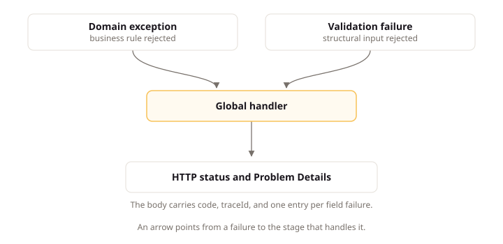

# HTTP API

**Stack:** any
**Concern:** web-api

The WebApi layer is the thin HTTP boundary of a LiteSpec backend. It turns each HTTP request into a message for the Application layer, dispatches that message, and maps the result back to a stable HTTP response. This page is for developers who build endpoints, routes, and the generated OpenAPI contract. A boundary that takes on behavior or invents its own contract drifts from the records, so each rule below keeps the boundary thin and the contract derived from code.

## Concepts

### Endpoints Carry One Operation

An endpoint converts HTTP input to an Application message, dispatches that message through its mediator, and maps the result to the HTTP response. One endpoint class serves one route operation and sits in the `WebApi/{Aggregates}/{UseCase}/` folder of its use case, with module-level reads dropping the aggregate segment. Endpoints with no use case live in the host project: protocol endpoints, static assets, and development-only tooling, each carrying the mark naming the record it serves.

The Claimwick submit-expense endpoint shows the shape: it reads the HTTP request, maps it to the submit command, dispatches the command through the command mediator, and maps the result to the response. It holds no business rule, reaches no store, calls no provider, and catches no failure. Behavior lives in the handler, target authorization lives in the application guard, and error responses come from the one global handler. An endpoint constructor takes mediators and HTTP-boundary services such as the actor accessor, while a handler takes no mediator and no HTTP-boundary service.

Endpoint policies check the caller, while the guard decides on the target. An endpoint enforces coarse authenticated, role, or scope policies and applies a stable forbidden-or-not-found policy where revealing that a resource exists leaks information. A use case that a provider callback runs keeps its pipeline handler in the module `Infrastructure/Pipeline/` folder carrying the use case mark as its endpoint, so the use case maps no route and no screen calls it.

### Errors Share One Shape and One Handler

Every error response uses RFC 9457 Problem Details: a standard body carrying a stable application `code`, the current `traceId`, and one `errors` entry per field failure. The stable code lets a client branch on the failure without parsing prose, and the trace identifier ties the response to its diagnostics. One global handler produces every error response from every failure type, so the same failure answers the same status and code from every endpoint.

The Claimwick product shows the consistency: reimbursing an expense that is not approved answers 422 with the code `spending.not-approved`, whatever endpoint received the request. The outcome table below assigns each result its status, and the global handler answers exactly that status. Only an unexpected fault answers 500, so a 500 reading means the server failed.

| Outcome | Status |
|:---|:---:|
| Successful read | 200 |
| Successful command with a response body | 200 |
| Successful creation of a readable resource | 201 with the resource location |
| Successful creation without a read route | 201 |
| Successful command without a response body | 204 |
| Structural validation failure | 400 |
| Missing or invalid authentication | 401 |
| Authenticated but forbidden | 403 |
| Resource unavailable under the disclosure policy | 404 |
| Absent details of a single-resource query | 404 |
| Generic conflict or unstated rule | 409 |
| Written refusal | The status its refusal record states |
| Upstream refusal | 503 |
| Abuse limit exceeded | 429 with a `Retry-After` header |
| Accepted background operation | 202 with status location |
| Unexpected failure | 500 |

### Routes Name Resources

A route uses lowercase plural resource segments, kebab-case subresources, route parameters for identity, query parameters for filtering, and the body for command data. A route carries the authenticated actor identifier with the actor intentionally addressing another actor as a resource. For a transition past the five verbs, AIP-136 defines the custom-method form.

A command route carries the aggregate plural, and a custom action ends with the use-case verb as its last segment: `POST /api/expenses/{id}/reimburse`. A POST to the collection, a PUT, PATCH, or DELETE on one resource, and a verb the HTTP method already states keep the plain resource route. A partial update travels as PATCH with the `application/merge-patch+json` media type and names the changed members in the body; a PUT replaces the whole resource, and DELETE stays a hard-state transition. Each path parameter names its own resource identity, as in `/api/posts/{postId}`, while a `details` segment takes the aggregate name.

### Collections Page with Cursors

A collection endpoint applies deterministic ordering with the default limit and the maximum limit its use-case record declares, capped at 100. A use case with stricter needs declares its smaller maximum in its record `paging` with the reason on the record. A collection over a proven bounded dataset declares offset paging in its record with the bound that makes it safe, while the public contract stays cursor-shaped.

Paging cursors stay opaque: a malformed cursor, or an unsupported cursor version, answers 400 with code `invalid-cursor`. A cursor carries a version with the last stable sort values, including a unique tie-breaker matching the query order, and no sensitive value in readable form. A request uses `after` as the opaque cursor with `limit` as a positive integer, and the endpoint reads one record past the limit to find the next page. The response uses one shape with `items` and a `page` holding `limit`, `nextCursor`, and `hasMore`.

### The Contract Derives from Code

The OpenAPI document generates during the Release build from the code, with no handwritten copy. Each operation declares a stable `operationId` for client method names, with its authorization, request, success, and Problem Details metadata, plus an explicit summary. Comments on handlers carry no contract documentation. The committed artifact lives at `apps/api/openapi/{ProjectName}.json` when a frontend or external consumer reads the API, so each contract change shows in review and the gate fails on a document that went unregenerated.

Declared security schemes and per-operation requirements derive from the registered authentication schemes, and an operation with an anonymous grant declares no security requirement. Each schema declares the closed value set, bounds, format, and control headers of its fields, such as `Idempotency-Key` or `If-Match`, with closed sets and result shapes derived from code rather than handwritten copies. Build-time generation boots the host, so a composition that starts with a secret, a certificate, or a reachable dependency behind it generates from a generation environment without hosted dependencies or moves each startup refusal to first use, with the project recording the answer it uses. API exploration and diagnostic endpoints map in Development only.

### Field Shapes Stay Uniform

A transport model mirrors the Domain closed set behind it: a label-only set publishes a string `enum`, while a data-bearing set maps to a polymorphic model with one case per variant, published as `oneOf` with a string discriminator such as `type` or `outcome`. The discriminator strings equal the Domain union stable case codes. Each wire contract is a dedicated transport model in the endpoint folder; the public contract reuses no Domain or Application type, and each layer keeps its own contract type.

Numbers, money, booleans, time, and vocabulary follow the transport conventions stated below: plain numbers, one `Money` object, camel-case condition names, the `At` suffix, and shared words such as `created`, `languageTag`, and `displayName`. A request body names a failure with `code` for the class and `reason` for the explanation, mirroring the response pair. Field names carry no type prefix and no noise word from the `data`, `info`, `item`, `object`, `value`, `thing` list. Transport types take the names the suffix table assigns their boundary roles, so a passive HTTP DTO ends in `Model`.

## Standards

### Return Stable Problem Details

**ID:** `litespec/core/backend-api#return-stable-problem-details`

**Strength:** required

**Applies to:** artifact: any

**Statement:** An error response MUST use [RFC 9457](https://datatracker.ietf.org/doc/html/rfc9457) Problem Details carrying a stable application `code`, the current `traceId`, and an `errors` entry for each field failure.

**Rationale:** A stable code lets a client branch on the failure without parsing prose, and the trace identifier ties the response to its diagnostics. One entry per field failure reports the whole request in a single answer, and one handler keeps every endpoint consistent.

**Example:** A validation failure returns this body:

```json
{
  "type": "https://example.test/problems/validation",
  "title": "Request validation failed",
  "status": 400,
  "detail": "One or more values are invalid.",
  "instance": "/api/posts",
  "code": "validation-failed",
  "traceId": "4bf92f3577b34da6a3ce929d0e0e4736",
  "errors": [
    {
      "field": "title",
      "code": "required",
      "message": "Title is required."
    }
  ]
}
```

`type` is a stable absolute URI owned by the consumer. `errors` appears with validity findings, carrying their member, code, and message. `code` carries the refusal result stable code, and `detail` carries the free-form prose explanation. WebApi maps Application member names to their public JSON field names. `traceId` carries the trace identifier from the current [W3C Trace Context](https://www.w3.org/TR/trace-context/) `traceparent`, with the request identifier as fallback. The same shape applies to authentication and authorization failures.

The global handler maps validation failures to 400 and missing targets through the operation disclosure policy. It maps forbidden failures to 403 or the declared 404. The derived `invalid-input` refusal answers 400, the derived `forbidden` refusal answers 403 or the declared 404, and the derived `conflict` and `rule-not-stated` refusals answer 409. Each written refusal answers the status its refusal record states. Unexpected failures answer 500 with code `internal-error`. It maps each known domain failure individually. It reports no cancellation from a disconnected request as an application error.

In the Claimwick product, reimbursing an expense that is not approved ends with `result/reimburse-expense.not-approved`, which carries the code `spending.not-approved` and the status 422. The global handler answers:

```json
{
  "type": "https://example.test/problems/not-approved",
  "title": "Not approved",
  "status": 422,
  "detail": "The expense is not approved.",
  "instance": "/api/expenses",
  "code": "spending.not-approved",
  "traceId": "4bf92f3577b34da6a3ce929d0e0e4736"
}
```

The endpoint catches no failure.



**Reviewed for:** Does every error response carry the stable code, the traceId, and one errors entry per field failure? Look at the error responses at the API boundary.

### Bound Every File Upload

**ID:** `litespec/core/backend-api#bound-every-file-upload`

**Strength:** required

**Applies to:** artifact: endpoint; when: upload

**Statement:** A file upload operation MUST accept no file larger than the size its use-case record declares and no media type outside the media types its use-case record declares.

**Rationale:** A declared size and media-type bound tells the server what to accept before storage, and tells a reviewer the limit beside the use case that owns the file. An upload without both bounds lets one caller send work the server agreed to neither store nor inspect.

**Example:** The Claimwick submit-expense upload declares the size and the image media types a receipt photo carries. The server turns away a larger file or another media type before it stores anything.

**Reviewed for:** Does every upload operation declare its size and media-type bounds, and refuse files outside them? Look at each upload endpoint beside its use-case record.

### Prove Every Upload Type from Its Content

**ID:** `litespec/core/backend-api#prove-every-upload-type-from-its-content`

**Strength:** required

**Applies to:** artifact: endpoint; when: upload

**Statement:** A file upload operation MUST determine the file type from the file content rather than the media type or file name the client claims.

**Rationale:** A claimed media type and a file name are caller input. Either one says image while the bytes carry something else. Reading the type from the content enforces the declared media-type bound on what the server stores rather than on what the caller says it sent.

**Example:** A Claimwick receipt photo named as an image stores as an image with the bytes reading as one of the declared image types. Bytes of another type meet a refusal, even with the name and claimed type agreeing.

**Reviewed for:** Does every upload operation read the file type from the bytes rather than the claimed media type or file name? Look at the type check of each upload endpoint beside the declared media types.

### Store Every Upload Through Infrastructure

**ID:** `litespec/core/backend-api#store-every-upload-through-infrastructure`

**Strength:** required

**Applies to:** artifact: command-handler, endpoint; when: upload

**Statement:** File storage for an upload MUST live in Infrastructure.

**Rationale:** File storage is provider work beside aggregate storage. Infrastructure owns the storage provider, its configuration, and its errors, so a project changes where files live without touching an endpoint or a handler.

**Example:** The Claimwick endpoint for a receipt photo converts the request to its command and dispatches it, the handler stages the expense, and Infrastructure writes the photo bytes to the configured store.

**Reviewed for:** Does any endpoint or handler write file bytes to a storage provider directly? Look at the upload endpoints and handlers beside the Infrastructure storage code.

### Authorize Every File Download Through Its Owning Use Case

**ID:** `litespec/core/backend-api#authorize-every-file-download-through-its-owning-use-case`

**Strength:** required

**Applies to:** artifact: endpoint; when: upload

**Statement:** A caller MUST reach a stored file only through a download use case authorized from the access that use case declares.

**Rationale:** A stored file carries the data of the record it belongs to. A direct storage address serves that data to anyone holding the address, past the owning grant and tenant scope. Routing each download through its owning use case keeps one authorization decision for the file and for its record.

**Example:** A Claimwick receipt photo downloads through the use case that owns the expense, so the declared access decides who reads the photo, and no storage address serves it on its own.

**Reviewed for:** Is every stored file reachable only through a download use case with its declared access? Look at the download endpoints and the storage addresses beside each owning use case.

### Require the Marker Header on Cookie-Authenticated Writes

**ID:** `litespec/core/backend-api#require-the-marker-header-on-cookie-authenticated-writes`

**Strength:** required

**Applies to:** artifact: any

**Statement:** The API MUST refuse a cookie-authenticated write without the project's marker header.

**Rationale:** Cookies travel with every request, including ones a malicious page triggers. A page on another site adds no custom header, so a missing header exposes a cross-site forgery. A write is any request other than GET, HEAD, or OPTIONS.

**Example:** The header takes the form `X-<Project>-Request: 1`, with the exact name set in project configuration. The refused request answers 401, since it arrives unauthenticated.

**Reviewed for:** Does every cookie-authenticated write without the marker header answer 401? Look at the write requests with cookie authentication.

### Bound Collection Queries

**ID:** `litespec/core/backend-api#bound-collection-queries`

**Strength:** required

**Applies to:** artifact: endpoint; when: query

**Statement:** A collection endpoint MUST apply deterministic ordering, its record's declared default limit, and its record's declared maximum limit of 100 or lower.

**Rationale:** One unbounded read causes unbounded database and serialization work. Deterministic ordering keeps pages stable, the declared default limit bounds the common case, and the declared maximum of 100 or lower caps the worst case. The use-case record declares its paging with order, cursor or offset, default limit, and maximum limit, and the endpoint applies exactly that.

**Example:** A request uses `after` as an opaque cursor and `limit` as a positive integer. The implementation fetches one record beyond the requested limit to determine whether another page exists. The response uses one shape:

```json
{
  "items": [],
  "page": {
    "limit": 20,
    "nextCursor": null,
    "hasMore": false
  }
}
```

**Reviewed for:** Does every collection response apply deterministic order with the declared default and maximum limits? Look at the collection responses beside their records.

### Declare Stable Operation Metadata in the Contract

**ID:** `litespec/core/backend-api#declare-stable-operation-metadata-in-the-contract`

**Strength:** required

**Applies to:** artifact: endpoint

**Statement:** An operation MUST declare a stable `operationId`, its authorization, request, success, and Problem Details metadata, and a summary.

**Rationale:** Generated clients name their methods from `operationId`. An unstable name renames client code on every generation. Authorization metadata cites the enforced policies and Problem Details metadata covers each documented failure status, so the client models security and failure before its first call. Comments on handlers carry no contract documentation, so operations carry explicit summaries.

**Reviewed for:** Does every operation in the generated contract declare its operationId, authorization, request, success, failure, and summary entries? Look at the operations in the generated contract.

### Name the Use Case on Every Published Operation

**ID:** `litespec/core/backend-api#name-the-use-case-on-every-published-operation`

**Strength:** required

**Applies to:** artifact: endpoint

**Statement:** Every operation in the generated contract MUST carry `x-litespec-use-case` naming the use case its endpoint implements.

**Rationale:** The `operationId` names an operation for client code, cased for method names, so it carries no record identifier. The extension holds the identifier itself, which the OpenAPI specification reserves for this kind of metadata, and takes an integrator from an operation straight to its specification page. The value comes from the generated map of operation names to use cases, so it is written once, in the endpoint mark.

**Example:** The Claimwick operation `SubmitExpense` carries `"x-litespec-use-case": "use-case/spending.submit-expense"`.

**Checked by:** `litespec model check` reports `operation-use-case-drift` (level S) for an operation in the committed contract whose `x-litespec-use-case` is missing or differs from the use case its endpoint's mark names.

### Keep One Name for a Use Case Across Layers

**ID:** `litespec/core/backend-api#keep-one-name-for-a-use-case-across-layers`

**Strength:** required

**Applies to:** artifact: endpoint, use-case

**Statement:** Each use case MUST carry its name unchanged in its message type, operation id, and audit action.

**Rationale:** A use case that reads one way in its record, another in its message type, and a third in its audit action forces every trace across layers through a translation table held by the author alone. The record id is the name; the message type, the endpoint operation id, and the audit action repeat it in their own casing, so a reader follows one name from the page to the wire to the audit log.

**Example:** `use-case/spending.reimburse-expense` travels as `ReimburseExpenseCommand`, operation id `ReimburseExpense`, and audit action `reimburse-expense`; an operation id of `PayExpense` is reported.

**Reviewed for:** Does every message type, operation id, and audit action carry its use case name? Look at each use case's message type, operation id, and audit action beside its record.

## Conventions

### Keep Numeric Transport Types Precise

**ID:** `litespec/core/backend-api#keep-numeric-transport-types-precise`

**Strength:** default

**Applies to:** artifact: endpoint

**Default:** Emit a plain numeric schema for an `int32` or `double` field, and reserve a string-or-number union for `int64` values beyond the JSON safe integer range.

**Replacement:** A project names its numeric wire shapes in its backend documentation.

**Rationale:** A plain numeric schema lets consumers read `int32` and `double` directly. A broad union on every integer forces each consumer to coerce plain numbers, so the union stays reserved for `int64` values past the safe range.

**Reviewed for:** Does every numeric field publish a plain schema, with the int64 union reserved for values beyond the safe range? Look at the numeric fields in the contract.

### Model a Monetary Value as One Object

**ID:** `litespec/core/backend-api#model-a-monetary-value-as-one-object`

**Strength:** default

**Applies to:** artifact: endpoint

**Default:** Carry a monetary value as one `Money` object in a response model and in a request where the caller chooses the currency, with `amount` as an invariant decimal string and `currency` as an ISO 4217 code.

**Replacement:** A project names its money wire shape in its backend documentation.

**Rationale:** Split sibling fields pair by a server invariant no schema shows, so a report reads the two independently and mismatches them. One `Money` object holding `amount` and an ISO 4217 `currency` mirrors the Domain shape on the wire. The amount travels as a string, not as a JSON number, so no reader parses it as binary floating point.

**Example:** `unitPrice` and `currencyCode` become `price` of type `Money`, traveling as `{ "amount": "12.50", "currency": "EUR" }`. A request that references an account with a fixed currency carries `amount` alone.

**Reviewed for:** Does every monetary value travel as one Money object with a string amount, with currency where the caller chooses it? Look at the monetary fields in the contract.
