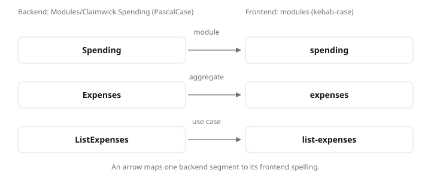

# Frontend Structure

**Stack:** any
**Concern:** frontend-ui

LiteSpec gives a frontend three parts: the frame, which holds what every route shares; routes, with one entry per address; and modules, with one folder per backend use case the frontend calls. The module tree mirrors the backend module folders in kebab case, so a reader holding a use case specification finds the frontend code that serves it without a second map.

This page states where each frontend file belongs and how imports point between the parts. Frontend developers and agents apply it whenever they add or move frontend code.

## Concepts

### Frame, Routes, and Modules

A frontend has three parts. The frame holds the cross-route values: client configuration, session read, language choice, permissions, formatting, and shell data. Routes hold one entry per address the frontend serves. Modules hold one folder per backend use case the frontend calls. Each frontend is one entry-point record, owning its routes, environment, session handling, words, tests, and deployment.

### How Modules Mirror the Backend

The module tree mirrors the backend module tree in kebab case: `{module}/{aggregates}/{use-case}/`, where module, aggregates, and use case are the backend's three grouping names. Kebab case means lowercase words joined by hyphens, so `ListExpenses` becomes `list-expenses` and `Expenses` becomes `expenses`. A module-level read drops the aggregate segment in both trees.

A reader translates the three backend names to lowercase folders to find the frontend code that serves the use case.

### How Imports Point Between Layers

Imports point one way, from routes toward shared packages: routes import modules, modules import the frame, and the frame and modules import shared packages.

That direction keeps four concerns separate: addresses in routes, use-case code in modules, cross-route values in the frame, and shared code in packages.

## Standards

### Organize a Frontend into Frame, Routes, and Modules

**ID:** `litespec/frontend/structure#organize-a-frontend-into-frame-routes-and-modules`

**Strength:** required

**Applies to:** artifact: any

**Statement:** A frontend MUST organize its code into a frame, routes, and use-case modules.

**Rationale:** Every new file raises one question: is it cross-cutting, is it an address, or does it serve one use case. Without the split, shared values hide inside routes, use-case code hides inside shared folders, and no author can tell where a new file belongs. The three parts answer the question, so each file belongs in one place.

**Example:** Each stack page maps the same three parts onto its own toolchain:

```text
{frontend}/
  frame/     client configuration, session, language, permissions, formatting, shell data
  routes/    one entry per address
  modules/   one folder per backend module and use case
```

**Reviewed for:** Does every frontend file sit in the frame, routes, or use-case modules? Check the frontend folder roots.

### Mirror the Backend Use Case Path in Kebab Case

**ID:** `litespec/frontend/structure#mirror-the-backend-use-case-path-in-kebab-case`

**Strength:** required

**Applies to:** artifact: any

**Statement:** A use-case folder on a web or Blazor frontend MUST sit under the modules root at `{module}/{aggregates}/{use-case}/` in kebab case, resolving to the backend `Application/{Aggregates}/{UseCase}/` folder of the same names, with a module-level read dropping the aggregate segment in both trees.

**Rationale:** A reader holding a specification page finds the frontend code by translating three names to lowercase folders. No second map, index, or naming register stands between the specification and the code, so an agent given a use case identifier resolves its frontend folder by rule. The backend holds one aggregate folder with one folder per use case inside it, so the mirror names both. The mirror covers web and Blazor frontends; an Android frontend keeps no module mirror, as the [Android Stack](mobile/android/stack.md) states. The frontend structure test checks the mirror on every build, under `litespec/frontend/testing#prove-the-module-mirror-in-a-structure-test`.

**Example:** One backend folder and its frontend counterpart are the same path in two spellings:

```text
<backend>/Orders/Application/MerchantOrders/SearchMerchantOrders/
<frontend>/modules/orders/merchant-orders/search-merchant-orders/
```

In Claimwick, `use-case/spending.list-expenses` lists expenses. The backend implements it under `Spending/Application/Expenses/ListExpenses`, and the web frontend serves it from the same path in kebab case, `lib/modules/spending/expenses/list-expenses`, beside the screen record `screen/claimwick-app.expense-list`.

```text
<backend>/Spending/Application/Expenses/ListExpenses/
<frontend>/modules/spending/expenses/list-expenses/
```

The three backend names become three lowercase folder names, while the `Application/` layer segment has no counterpart in the frontend path.

A module-level read keeps its record home under `use-cases/` beside its module, and drops the aggregate segment in both trees. A query named `use-case/spending.read-spending-summary` would live at `<frontend>/modules/spending/read-spending-summary/` and `<backend>/Spending/Application/ReadSpendingSummary/`. The running Claimwick example holds no such module-level query.

The diagram shows the backend path beside its frontend mirror, with one arrow per translated segment.



**Checked by:** `litespec model check` reports `code-placement-drift` for a use-case folder whose path does not mirror its marked use case, and for a folder segment outside kebab case.

### Keep a Use Case Folder Flat

**ID:** `litespec/frontend/structure#keep-a-use-case-folder-flat`

**Strength:** required

**Applies to:** artifact: any

**Statement:** A folder named for one use case MUST hold files and no subfolder.

**Rationale:** A subfolder inside a use case folder names a grouping the backend does not have, so the one-to-one mirror between the two trees stops at that point. Past the subfolder, the reader can no longer translate names by rule, and nothing reports where the translation broke. Files directly in the use case folder keep the whole mirror checkable.

**Reviewed for:** Does every use-case folder hold files with no subfolder? Check the module tree.

### Place a Shared File in the Folder That Owns It

**ID:** `litespec/frontend/structure#place-a-shared-file-in-the-folder-that-owns-it`

**Strength:** required

**Applies to:** artifact: any

**Statement:** A file read by several use cases of one module MUST sit flat in that module's folder.

**Rationale:** A file read by several use cases of one module belongs flat in that module's folder: the lowest folder holding every consumer. There it sits beside its consumers, found by browsing rather than through an index, and moving it changes nothing outside the module.

**Example:** Three expense queries share one tab strip, so the tab strip sits flat in the module folder.

**Reviewed for:** Does every file read by several use cases sit in the narrowest folder holding every consumer? Check the module folders.

### Reject a Folder Name That Owns Nothing

**ID:** `litespec/frontend/structure#reject-a-folder-name-that-owns-nothing`

**Strength:** required

**Applies to:** artifact: any

**Statement:** A folder under an application's `src` MUST NOT be named `shared`, `common`, `utils`, `util`, `helpers`, `misc`, `components`, `hooks`, `types`, or `services`.

**Rationale:** A folder named `shared`, `utils`, or `components` accepts anything. Every author with a file of unclear ownership puts it there, so the folder collects unrelated code that escapes review against the use cases it serves. Finding a file then means searching mixed code instead of translating a use case path. Refusing these names forces each file into the folder that owns it. The rule covers an application's `src`, not a shared package's internals, which the package owns.

**Example:** A shared query three use cases read sits flat in the module folder, not in a `shared/` folder beside them.

**Checked by:** `litespec model check` reports `code-placement-drift` for a folder under the frontend modules root carrying a refused name.

### Keep a Route Entry Thin

**ID:** `litespec/frontend/structure#keep-a-route-entry-thin`

**Strength:** required

**Applies to:** artifact: route

**Statement:** A route entry MUST hold its input, its load, and its component, with no reusable logic and no reference to another route entry.

**Rationale:** A route entry serves one address: its input, its load, and its component. A column definition or validation rule written in a route entry stays unreachable from the second route that needs it, so the second route writes its own copy. A reference from one route entry to another ties one address to another, so changing the first breaks the second. Reusable logic lives in modules instead, where both routes import it.

**Example:** An expense list route validates its search input, prefetches its read, and composes one screen from module components.

**Reviewed for:** Does every route entry hold only its input, load, and component, with no reusable logic and no reference to another route entry? Check the route entries.

### Mark Each Route with Its Screen

**ID:** `litespec/frontend/structure#mark-each-route-with-its-screen`

**Strength:** required

**Applies to:** artifact: route

**Statement:** A route entry MUST carry one mark naming the screen it renders, in the form its stack page states.

**Rationale:** The route is where a screen record is implemented in code, and its folder or file name only resembles the screen. One mark writes that link down so tools can check it.

A web route exports the same typed `litespec` constant a use-case module exports, so a wrong identifier fails the consumer's type check against the generated union, and `litespec model check` reports it as `mark-unknown` where no type check ran. A Blazor component or an Android destination carries the .NET mark the .NET reader reads. Each stack page states its route entry, the file or class that carries the mark, and that layouts, error pages, and route groups are not route entries: the [Svelte Stack](web/svelte/stack.md), [React Stack](web/react/stack.md), [Blazor Stack](blazor/stack.md), and [Android Stack](mobile/android/stack.md) pages state theirs.

The use cases a screen offers are not marked on the route; the builder computes them from its calls.

**Example:** The `<script module>` of the Claimwick expense list page exports `export const litespec = { implements: "screen/claimwick-app.expense-list" } as const satisfies LiteSpecMark;`, naming the screen it renders.

**Checked by:** `litespec model check` reports `mark-missing` (level S) for a route entry with no mark, `mark-count-invalid` (level S) for one with more than one, and `mark-unknown` (level S) for a mark naming no screen of the route's entry point.

### Order Imports from Routes to Shared Packages

**ID:** `litespec/frontend/structure#order-imports-from-routes-to-shared-packages`

**Strength:** required

**Applies to:** artifact: any

**Statement:** An import MUST point from a route to a module to the frame to a shared package, and never in the reverse direction.

**Rationale:** A module importing a route ties use-case code to one address, and a shared package importing an application ties every application to one application's choices. Each reverse import collapses two layers into one. One direction, from routes to modules to the frame to shared packages, keeps addresses, use-case code, cross-route values, and shared code in separate layers, with each layer usable without the layers above it.

**Example:** The allowed dependency path runs one way:

```text
Routes -> modules -> frame -> shared packages
```

That direction rules out three imports: a module reaching a route, a shared package reaching an application, and a frame module reaching into one module's use-case folder for a second module's data.

**Reviewed for:** Does every import point from a route to a module to the frame to a shared package, with none in the reverse direction? Check the import statements.

### Keep Applications Independent

**ID:** `litespec/frontend/structure#keep-applications-independent`

**Strength:** required

**Applies to:** artifact: any

**Statement:** A frontend MUST NOT import source from another frontend.

**Rationale:** An import from another application's source ties the two together: a change to one breaks or redeploys the other. Each application owns its routes, its environment, its session handling, its words, its tests, and its deployment, so it can change, test, and ship on its own. Code two applications genuinely share moves into a shared package, which names neither application.

**Reviewed for:** Does any frontend import source from another frontend? Check the import statements.

### Keep Shared Packages Free of Application Code

**ID:** `litespec/frontend/structure#keep-shared-packages-free-of-application-code`

**Strength:** required

**Applies to:** artifact: any

**Statement:** A shared package MUST NOT contain page composition, feature state, authentication policy, or application components.

**Rationale:** Page composition, feature state, authentication policy, or application components kept in a shared package would bind every application to one application's choices. Shared packages hold only what serves every frontend and names none of them: the generated client, the shared UI package, the locale dictionaries, and the frontend tooling. Application-specific code stays in the application, where it can change without touching the rest.

**Reviewed for:** Does any shared package hold page composition, feature state, authentication policy, or application components? Check the shared package sources.

### Place Cross-Route Values in the Frame

**ID:** `litespec/frontend/structure#place-cross-route-values-in-the-frame`

**Strength:** required

**Applies to:** artifact: any

**Statement:** A frontend MUST place cross-route values in its frame: client configuration, session read, language choice, permissions, formatting, and shell data.

**Rationale:** A route holding a cross-route value keeps a copy beside every other route's copy, with nothing keeping the copies equal. Client configuration, session read, language choice, permissions, formatting, and shell data cross every route, so the frame holds each once, where every route can use it. A browser API a use-case module needs belongs in the frame for the same reason: a module renders and reads data rather than calling the browser directly.

**Reviewed for:** Which cross-route values or browser API uses sit outside the frame? Check the frame.

## Conventions

### Use Explicit Public Entry Points for Shared Packages

**ID:** `litespec/frontend/structure#use-explicit-public-entry-points-for-shared-packages`

**Strength:** default

**Applies to:** artifact: any

**Default:** Expose a shared package only through its documented public entry points.

**Replacement:** A consumer can replace this default with an explicit local convention.

**Rationale:** An application importing an internal path couples itself to that layout, so the next rearrangement breaks the application. A shared package rearranges its internals between releases, while its documented public entry points are the stable surface it keeps.

**Reviewed for:** Does every application import stop at the documented public entry points of shared packages? Check the application imports and the package manifests.

### Place Tests at Their Ownership Boundary

**ID:** `litespec/frontend/structure#place-tests-at-their-ownership-boundary`

**Strength:** default

**Applies to:** artifact: test

**Default:** Place a logic test beside its module, and keep browser suites under one tests root per frontend.

**Replacement:** A consumer can replace this default with an explicit local convention.

**Rationale:** Scattering browser suites beside modules would split the fixtures and the runs, because browser suites share one fixture set and one deployment per frontend. One tests root per frontend keeps them together. A logic test instead sits beside its module, so it is found with the code it covers and runs with it.

**Reviewed for:** Does every logic test sit beside its module, and does every browser suite sit under the one tests root per frontend? Check the module folders and the tests roots.

## Reference Example

This informative example demonstrates `litespec/frontend/structure#mirror-the-backend-use-case-path-in-kebab-case`, `litespec/frontend/structure#place-a-shared-file-in-the-folder-that-owns-it`, and `litespec/frontend/structure#reject-a-folder-name-that-owns-nothing`.

A search use case folder holds its query definition and its table at `{module}/{aggregates}/{use-case}/` in kebab case. The module folder holds the tab strip its three sibling use cases share. Nothing sits in a `shared/` folder, because that name owns nothing.
