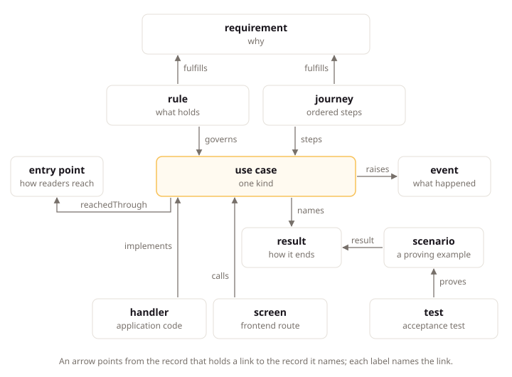

# How LiteSpec Works

## Intent

LiteSpec connects what a team writes about a product to the code that implements it, and checks that the two still agree. This page explains the parts, the record layers and the tools, then follows one use case of Claimwick, the example product in `examples/claimwick/`, from its written record to the check that confirms it. The worked example is in [The Claimwick Product](../example/the-product.md) and the pages after it.

## The Parts

LiteSpec has four parts. Each one answers a different question.

| Part | What it is | The question it answers |
|:---|:---|:---|
| The standard | The pages of one LiteSpec release, carried by the installed tool | How do we build? |
| Records | Short YAML record files in your project, each with an optional Markdown explanation beside it | What do we build, and why? |
| The model | What `litespec model check` and `litespec model query` compute from the records and the marks in code and tests | Does what we built match what we wrote? |
| The tools | The `litespec` command line, the analyzers and the published site | Is everything consistent, and what is missing? |

Your project installs one LiteSpec release, as a local .NET tool or as a standalone binary. The installed release does not change under you. When you want a newer one, you move the version.

Every rule in the standard is a provision with one ID, such as `litespec/backend/dotnet/domain#model-every-closed-set-of-domain-values-without-enums`. Each provision states its strength, `required`, `default` or `advisory`, and where it applies. Before editing a file, run `dotnet litespec rules <path>` to list the provisions that apply to it.

## The Four Layers

Every record answers one layer's question, and each layer is written from the layer above it.

| Layer | Question | Records |
|:--|:--|:--|
| Intent | Why build it, and what do we promise? | Product, module, goal, problem, feature, requirement, constraint, decision, research, journey, actor, role |
| Behavior | How does the system behave to keep the promises? | Aggregate, rule, event, integration event, use case, result, scenario, reaction, job, notification, setting, permission, entry point, screen, external system |
| Implementation | How is it built? | Code, technical decisions, runbooks |
| Proof | How do we know it holds? | Tests, check results, the computed completion, the rendered book |

A project claims the layers it uses in `layers` in `.litespec/project.yaml`. Three translation rules join them. **Specify** turns Intent into Behavior: it adds states, refusals, data with its retention, and access with its tenant scope. It never invents a value that Intent does not state, such as a price, a rate or a retention period; the agent takes that question to the owner. **Implement** turns Behavior into code, and it adds no outcome, edge or access that no record declares. **Verify** turns code into Proof: one test proves each scenario through the public boundary.

Records state only software. Company matters such as prices as an offer, markets and launch dates enter only as a constraint or as dated research. A record that reaches no Behavior is unfinished work or not software, and the check reports it.

A departure is the one record that sets a rule or a finding aside. It lives in `.litespec/governance/departures/`, names what it covers and why, and carries an `expiresOn` date when the gap is meant to close.

## Record Types and Their Homes

The folder is part of the record. A record's folder is its parent: the product, a module, an aggregate or an entry point. Every other folder name comes from a closed set per layer, and anything else is a blocking finding. The Claimwick tree shows the pattern:

```text
.litespec/intent/
  product.yaml
  goals/  problems/  constraints/  decisions/  research/  actors/  roles/  journeys/
  modules/
    spending/
      module.yaml
      features/
        approval.yaml            the feature, with its requirements as entries
.litespec/behavior/
  modules/
    spending/
      expenses/                  an aggregate's folder
        aggregate.yaml
        submit-expense.yaml      a use case
      rules/
        ...
```

Product-level records sit directly under `.litespec/intent/`, and the features of a module sit under its folder. The [model page](../core/model.md) lists every home of every type. Behavior follows the same name under `.litespec/behavior/modules/<module>/`, and code follows it into `Spending` folders.

A record in git is decided. Git holds the history, and the pull request that changes a record is its review. A record no longer wanted is deleted.

Each record has one identifier, short and unique in the product, such as `use-case/spending.submit-expense`, and every link uses it. A record that moves to another module changes its identifier and every citation in the same change.

## A Use Case from Record to Code

Claimwick lets employees submit work expenses with receipts. In LiteSpec that behavior is a use case: one command or query with its access, its results and its scenarios.

### The Written Record

The record file is `.litespec/behavior/modules/spending/expenses/submit-expense.yaml`. It states what the use case is and how it connects to the other records:

```yaml
type: use-case
id: use-case/spending.submit-expense
title: Submit Expense
kind: command
access:
  grant: permission/submit-expense
  tenant: own
serves:
- journey/submit-and-reimburse#s1
fulfills:
- requirement/approval.receipt-over-threshold
reachedThrough:
- entry-point/claimwick-app
raises:
- event/expense.submitted
changes:
- aggregate/spending.expense
reads:
- aggregate/spending.policy
```

Read it as a set of facts. Submitting an expense is a command, which changes business state. It serves the first step of the journey and fulfills the rule that an expense above the receipt threshold carries a receipt. Only the holder of the `submit-expense` permission may run it, and the tenant scope stays with the caller's own expenses. It changes the expense aggregate and reads the policy for the threshold.

Each result is an entry in `records`, one way the use case ends. A refusal names the stable code the API returns:

```yaml
- type: result
  id: result/submit-expense.receipt-missing
  title: Receipt Missing
  outcome: refusal
  code: spending.receipt-missing
  meaning: The expense is above the receipt threshold and carries no receipt.
```

Each scenario is one worked example that leads from a given situation through one action to one named result. A scenario names exactly one result, so the test that proves it knows which ending it checks.

```yaml
- type: scenario
  id: scenario/submit-expense.submitting-with-a-receipt-succeeds
  title: Submitting with a Receipt Succeeds
  given: An employee paid for a train ticket and kept the receipt.
  when: The employee submits the expense with the receipt.
  then: The expense is submitted.
  result: result/submit-expense.submitted
```

### The Implementation

The standard states where code goes. The handler is `apps/api/src/Claimwick.Modules/Spending/Expenses/UseCases/SubmitExpense/SubmitExpenseCommandHandler.cs`, in a folder ordered by module, aggregate, `UseCases/` and use case. Each code element carries a mark, `<implements>use-case/spending.submit-expense</implements>`, naming the record it serves. The mark is the link the model builder follows. The refusal lives in the aggregate's own check, `Expense.Submit`, which throws `ExpenseReceiptMissingException` with the code `spending.receipt-missing`. The [example use case page](../example/a-use-case-in-code.md) shows that code.

### The Computed Links

Run the check from the project root:

```bash
dotnet litespec model check
```

It reads every record, follows the marks in the code and the tests, and reports each gap as a finding. Then ask about one record:

```bash
dotnet litespec model query use-case/spending.submit-expense
```

The answer holds the record's fields, its links, and what the builder computed from the marks. Run against the Claimwick example, the computed part reads:

```json
"computed": {
  "completion": {
    "stage": "coded",
    "proof": "unknown",
    "counts": {
      "code found": { "done": 1, "of": 1 },
      "scenarios verified": { "done": 0, "of": 2 }
    }
  },
  "proves": [
    {
      "claim": "scenario/submit-expense.submitting-with-a-receipt-succeeds",
      "confirmed": true,
      "passing": null
    },
    ...
  ]
}
```

The stage reads `coded`, because the handler exists. It does not read `verified`, because no test run has passed for the two scenarios. The builder computes these links again on every run, so they cannot go stale the way a hand-kept traceability table does. Nothing flows the other way: no record above Implementation is ever computed from code.

### The Reported Gaps

Each finding has a level. A level G finding reads records only and always blocks. A level S finding reads code through a stack reader and blocks where that reader is qualified. A level A finding advises and does not block by default. The check runs in CI, so a gap shows up in the pull request that introduced it.

In the Claimwick example, the export use case has no handler yet, and the check reports it as covered by a departure:

```text
.litespec/behavior/modules/spending/expenses/export-expenses.yaml:1 [covered S] [use-case-unimplemented] Use case 'use-case/spending.export-expenses' has no handler, reaction or job.
...
0 findings, 0 blocking, 26 covered.
```

A covered finding reports without blocking until the departure expires. To catch breaking changes against an older commit, run `dotnet litespec model check --since <base>`.

## Links Between Records

Records join through fields on the record that points. Access runs through three records and one grant. The Claimwick actor holds a role, the role allows permissions, and the use case declares one of them as its grant:

```yaml
# intent/actors/employee.yaml
holds:
- role: role/employee
  scope: self

# intent/roles/employee.yaml
allows:
- permission/submit-expense
- permission/list-expenses

# behavior/.../submit-expense.yaml
access:
  grant: permission/submit-expense
  tenant: own
```

Behavior also connects upward and sideways. A use case serves journey steps and fulfills requirements, so each use case answers Intent. A reaction names the events it answers, and a use case names every edge it causes. An undeclared edge is the defect the checks report.

The main records around one use case, and the three links the builder computes, are in this diagram:



## Completion Is Computed

Nobody writes whether a record is implemented or verified. The builder computes one completion stage for each requirement, use case, journey, feature and goal. The stages run from least to most complete: `unfulfilled`, `specified`, `coded` and `verified`.

A use case is `unfulfilled` when no scenario specifies it, `specified` when a scenario specifies it and no code implements it, `coded` when code implements it and not every scenario is verified, and `verified` when every scenario has a passing proof that is not stale. A parent takes the stage of its weakest child. With no test run in the model, a coded record stays `coded` with proof `unknown`, and an unknown proof never reads as a failure.

## The Tools

LiteSpec ships two command lines, one set of .NET analyzers and one published site. The `litespec` command line reads a consumer project and reports what it finds. It runs in the consumer root as `dotnet litespec <command>`, and the [command index](../tools/README.md) lists every command. The `litespec-maintain` command line serves the LiteSpec repository, and the analyzers flag rule breaks while code is built.

| Command | Repository | Reads | Writes |
|:---|:---|:---|:---|
| `litespec init` | Consumer | Release template and preset | `.litespec/project.yaml` |
| `litespec new` | Consumer | Templates and folder rules | One record file, with its identifier |
| `litespec rename` | Consumer | Records, marks and citations | Rewritten citations |
| `litespec rules` | Consumer | One path or record ID | The provisions that apply |
| `litespec model check` | Consumer | Records, code marks, routes and test runs | Findings with levels |
| `litespec model query` | Consumer | One record with its links | The record and its links |
| `litespec model render` | Consumer | The model | The marked regions of your pages |
| `litespec book` | Consumer | Records, marks and findings | One offline site |
| `litespec-maintain validate` | LiteSpec | Pages, templates, manifest and links | Diagnostics |
| `litespec-maintain provisions` | LiteSpec | The active standards | The provision index |

A new project starts once with `dotnet litespec init`. A change to intent runs `new`, the rules and the model commands, the code and the analyzers, then the CI gates that the [CI page](../quality/ci.md) selects for the changed areas. A gap shows up in the change that introduced it.

For an agent, the starting point is the provisions for one file and the selection index for the project, `https://litespec.dev/4.1.0/select/server.dotnet.svelte/llms.txt`. [Work with agents](working-with-agents.md) describes how an agent reads the standard.

## Next

[Read the standard](reading-the-standard.md) explains how the standard is organized and how to find the rules that apply to your project. [The Claimwick Product](../example/the-product.md) walks the same records in the example.
