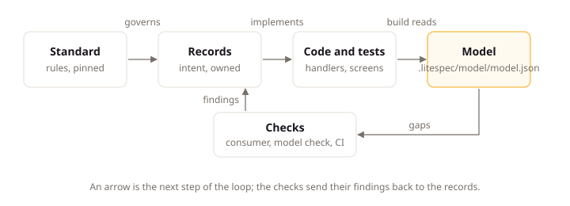

# How LiteSpec Works

## Intent

LiteSpec connects what a team writes down about a product with the code that implements it, and checks that the two still agree. This page shows that connection on Claimwick, the example product in `examples/claimwick/` where employees submit work expenses with receipts, following the Submit expense use case from its written record to the code that implements it and the check that confirms they match.

## The Parts

LiteSpec has four parts. Each one answers a different question.

| Part | What it is | The question it answers |
|:---|:---|:---|
| The standard | The pages of one LiteSpec release, carried by the installed tool | How do we build? |
| Records | Short YAML record files in your project, each with an optional Markdown explanation beside it | What do we build, and why? |
| The model | What `litespec model check` and `litespec model query` compute from your records and the marks in code and tests | Does what we built match what we wrote? |
| The tools | The `litespec` command line | Is everything consistent, and what is missing? |

Your project installs one LiteSpec release as a local .NET tool. The installed release never changes under you. When you want a newer one, you move the version.

The diagram below shows how the four parts connect, with each layer written from the layer above it and the checks sending their findings back to the records.



## A Use Case from Record to Code

Claimwick lets employees submit work expenses with receipts. In LiteSpec, that behavior is a use case: one command or query with its access, results, and scenarios. Reactions that answer events, jobs that run on a schedule or by hand, person-facing messages, and tunables are their own record types beside it.

### The Written Record

The record file lives in the project at `.litespec/behavior/modules/spending/expenses/submit-expense.yaml`. It states what the use case is and how it connects to other records:

```yaml
type: use-case
id: use-case/spending.submit-expense
title: Submit expense
kind: command
summary: An employee submits a work expense.
serves:
  - journey/submit-and-reimburse#s1
fulfills:
  - requirement/approval.receipt-over-threshold
access:
  grant: permission/submit-expense
  tenant: own
reachedThrough:
  - entry-point/claimwick-app
changes:
  - aggregate/spending.expense
reads:
  - aggregate/spending.policy
consistency:
  mode: atomic
raises:
  - event/expense.submitted
```

Read it as a set of facts: submitting an expense is a command, a message that changes business state; it serves the first step of the submit-and-reimburse journey and fulfills the requirement that an expense above the receipt threshold carries a receipt; the grant names the `submit-expense` permission from the shared list, and the tenant scope stays inside one tenant; employees reach it through the expenses app, whose door declares session authentication; it changes the expense aggregate, reads the policy store for the threshold, and commits atomically; and it raises an `expense.submitted` event, one statement that the submission completed. The `summary` field states what the use case is in one paragraph: "An employee submits a work expense."

Each result is an entry in `records`: one way the use case ends. Refusals are listed in precedence order, first match wins, and each refusal names the stable code the API returns:

```yaml
type: result
id: result/submit-expense.receipt-missing
outcome: refusal
code: spending.receipt-missing
meaning: The expense is above the receipt threshold and carries no receipt.
```

Two generic refusals are derived and never written: a use case whose grant is a permission derives a forbidden result, and a use case with rules on its input derives an invalid-input result. Their codes come from the `refusals` block in `.litespec/project.json`.

A record in git is decided. It carries no status, no owner, and no dates of its own history: git shows who changed what and when, and the pull request that changes a record is its review. A record no longer wanted is deleted, and git keeps its history.

The use case also carries a scenario: one worked example that leads from a given situation through an action to one named result.

```yaml
type: scenario
id: scenario/submit-expense.submitting-with-a-receipt-succeeds
given: An employee paid for a train ticket and kept the receipt.
when: The employee submits the expense with the receipt.
result: result/submit-expense.submitted
then: The expense is submitted.
```

Read it as one proven path: given the situation, when the employee acts, the use case reaches the `submitted` result, and the expense is submitted. Each scenario names exactly one result, so a later test knows which ending it proves.

### The Implementation

The standard states where the code goes and what shape it takes. A use case is implemented by one command handler in the application project, in a folder ordered by module, then aggregate, then use case:

```text
apps/api/src/Claimwick/Spending/Expenses/SubmitExpense/SubmitExpenseCommandHandler.cs
```

The use case folder is flat: the command, the result, the handler, the validator, the endpoint, and the request and response models sit beside each other. Each code element carries a mark naming the record it serves. The handler refuses an expense above the threshold that carries no receipt with the refusal code the result entry names. The folder mirrors the record, so any developer or agent knows where to look, and the mark is the link the model builder follows to find the handler.

### The Computed Links

Run the check from the project root:

```bash
dotnet litespec model check
```

It reads every record and follows the marks in the code and tests, the frontend routes, and the test runs. Then ask about one record:

```bash
dotnet litespec model query use-case/spending.submit-expense
```

Alongside the record's own fields, the answer holds what the builder computed from the marks:

```json
"computed": {
  "implemented": true,
  "verified": false,
  "implements": [
    "apps/api/src/Claimwick/Spending/Expenses/SubmitExpense/SubmitExpenseCommandHandler.cs"
  ],
  "calls": [],
  "proves": [
    {
      "scenario": "Submitting_with_a_receipt_succeedsAsync",
      "claim": "scenario/submit-expense.submitting-with-a-receipt-succeeds",
      "confirmed": true,
      "passing": null
    },
    {
      "scenario": "An_expense_is_submitted_through_a_helper_of_the_worldAsync",
      "claim": "scenario/submit-expense.submitting-with-a-receipt-succeeds",
      "confirmed": true,
      "passing": null
    }
  ]
}
```

The use case is implemented: the builder found its handler through its mark. Two tests claim its scenario: the test `Submitting_with_a_receipt_succeedsAsync`, whose `when` step belongs to the `SubmitExpenseSteps` class, and an integration test through a helper. Both claims check out, so each entry reads `confirmed`. The use case is still not verified: no test run exists yet, so `passing` is null. Nobody maintains those links by hand, and they cannot go stale, because the builder computes them again on every run. Nothing flows the other way: no record above Implementation is ever computed from code.

### The Reported Gaps

`dotnet litespec model check` turns gaps into findings with a level beside each one: level G checks read records only and always block, level S checks read code through a stack reader and block where that reader is qualified, and level A checks advise without blocking. A use case with no handler, a result the code never returns, a link to a record that does not exist, a journey step nothing serves, or a requirement nothing fulfills each becomes a finding. The check runs in CI, so a gap shows up in the pull request that introduced it.

For example, if the submit-expense record named no success result, `dotnet litespec model check` reports `[G use-case-success-missing]` against `.litespec/behavior/modules/spending/expenses/submit-expense.yaml`, and the pull request fails until the record names one.

To catch breaking changes against an older commit, such as a removed result or a changed integration event, run `dotnet litespec model check --since <base>`.

## The Provision Identifier

Every rule in the standard is a provision: one identified block with one assertion. Its ID joins its page and its heading. For example, the rule that every closed set of domain values is modeled without enums is `litespec/backend/dotnet/domain#model-every-closed-set-of-domain-values-without-enums`, on the [domain page](../backend/dotnet/domain.md). A review comment, an agent's report, or a project exception can cite that ID, and everyone knows exactly which rule is meant.

Each provision also states its strength: `rule`, `default`, or `advice`. A rule binds every project it applies to. A default binds unless the project records its own choice. Advice is experience to apply with judgement, and it records nothing. Each page states the scope its provisions apply to, and a provision narrower than its page names it. Before editing a file, an agent asks which provisions apply to it:

```bash
dotnet litespec rules apps/api/src/Claimwick/Spending/Expenses/SubmitExpense/SubmitExpenseCommandHandler.cs
```

The command lists the provisions grouped by strength, as one-line statements, with the project's own conventions and departures merged in.

## The Specification Is Closed

An agent builds what the specification states and nothing more. Something that seems missing becomes a question to the owner or an item on the backlog board outside the repository, never code. Ideas live on that board; what is in git is what the product wants.

## Next

[Read the standard](reading-the-standard.md) explains how the standard is organized and how to find the rules that apply to your project.
