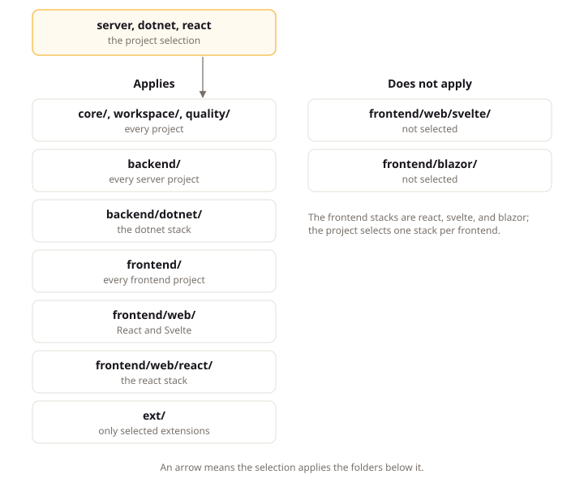

# Read the Standard

A project applies only the part of LiteSpec its selection names: a Svelte frontend follows different pages than a React one, and a project with no backend has no use for the API rules. The project records its selection in `.litespec/project.yaml`: its size, shape, technology stacks, the record layers it claims, and the extensions it selects. That selection decides which pages apply.

## A Project's Selection

The selection is four choices, plus any extensions the project selects:

| Choice | Options | What it changes |
|:---|:---|:---|
| Size | `small` or `large` | Which record types the project keeps. A large project adds goals, problems, features, flows, and scenarios, with the Acceptance project. |
| Shape | `server` or `client-only` | Whether the project has its own backend. A client-only project names no backend stack: the architecture, domain, and application pages still apply to its domain model, while the persistence, HTTP API, and API testing pages have no target. |
| Stacks | One backend stack for a server project, and one stack per frontend | Which technology pages apply: `dotnet` for the backend, and `react`, `svelte`, `blazor`, or `android` for a frontend. |
| Extensions | Any of the listed extensions, or none | Extra capabilities with their own rules, such as audit, multitenancy, an outbox, or realtime updates. |
| Layers | `intent`, `behavior`, `implementation`, `proof` | Which record layers the project claims: `litespec` for Intent and Behavior, `litespec` or `own` for Implementation and Proof; [Adopt LiteSpec in Steps](adopting-litespec.md) walks through the claims. |

`litespec init --preset dotnet-react --size small` writes a first project file with a common selection. The [selection page](https://litespec.dev/select/) on the site fills in the same choices in a form and shows which pages apply.

The Claimwick example in `examples/claimwick/` declares its own selection in `.litespec/project.yaml`:

```yaml
size: large
shape: server
stacks:
  - dotnet
  - svelte
selectedExtensions: []
layers:
  intent: litespec
  behavior: litespec
  implementation: litespec
  proof: litespec
```

That selection names size large, shape server, the dotnet and svelte stacks, no extensions, and every record layer under LiteSpec practice. It applies `backend/dotnet/` and `frontend/web/svelte/`, and it does not apply `frontend/web/react/` or `frontend/blazor/`. Layers build downward: Behavior needs Intent, and Implementation and Proof each need Behavior, so a project leaves layers out from the bottom.

The project file holds more than the selection. `paths` points at the folders the tools read, `refusals` names the codes the two derived generic results carry, and `reviewedLiteSpecVersion` records the release the team reviewed. The [project file page](../reference/project-file.md) lists every field.

## The Page Arrangement

The folder a page sits in decides which projects apply it:

```text
docs/
  core/  workspace/  quality/   every project
  backend/                      every project with a backend
    dotnet/                     projects that select the dotnet stack
  frontend/                     every project with a frontend
    patterns/                   UI patterns, for every frontend
    web/                        React and Svelte frontends
      react/  svelte/           each web stack
    blazor/                     Blazor frontends
    mobile/                     native mobile apps
      android/                  Android apps
  ext/                          only the extensions a project selects
```

Selecting a stack applies its folder, every folder above it, and their subfolders that hold no stack of their own. A React project applies `frontend/`, `frontend/web/`, and `frontend/web/react/`, and with `frontend/` it also applies `frontend/patterns/`, which holds no stack. The upper pages state the principle, for example that pages compose shared components only. The lower pages state how one stack follows it, for example which React component library and which test runner.

The diagram shows which folders a server project with the dotnet and react stacks applies, and which it does not.



The folders outside that map explain rather than govern. `learn/` holds these pages, `tutorial/` and `guide/` walk through tasks, `reference/` lists exact values, `example/` works through Claimwick, and `tools/` describes each command. The remaining folders serve those pages: the analyzer rules, the maintainer commands, LiteSpec's own records under `intent/`, and the diagrams under `assets/`.

## Page Sections and Provisions

A standards page carries the same sections every time:

- The lead says what the page covers, who applies it, and why it matters.
- Concepts, when present, explain the ideas the rules use.
- Standards holds the rules, each marked required or advisory.
- Conventions holds defaults the project may replace with its own.

Every rule on the page follows the same shape: a heading, then its ID line. Here is one from the [domain page](../backend/domain.md), quoted in full:

```markdown
### Keep Domain Independent of Outer Layers

**ID:** `litespec/backend/domain#keep-domain-independent-of-outer-layers`

**Strength:** required

**Applies to:** artifact: any

**Statement:** The Domain code MUST reference only the language standard library and project-owned Domain types.

**Rationale:** Domain that references only the language standard library and its own types compiles and tests with no infrastructure at all. Each banned reference would drag one outer concern into the business model: persistence metadata couples a rule to a store format, and dispatch plumbing couples it to delivery. Infrastructure registers a persisted discriminator instead, so Domain carries no serialization metadata.

**Reviewed for:** Does any Domain type reference code outside the language standard library and project-owned Domain types? Look at the references in the Domain code.
```

The **ID** line holds the rule's address: the page path, then the heading. The **Strength** line states how binding it is. `required` binds every project the rule reaches, `default` binds unless the project records its own choice, and `advisory` is experience to apply with judgment.

The **Statement** is the rule itself: one sentence with one capitalized word that sets its strength, as in internet standards: `MUST`, `MUST NOT`, `SHOULD`, `SHOULD NOT`, or `MAY`. Everything under **Rationale** and **Example** explains the rule and adds no obligation.

Each page states the scope its provisions apply to: the technology, the part of the system, and the kind of thing made. A provision carries its own **Applies to** line only when it governs less than its page. The last line of each rule is its verification. `**Checked by:**` names the command that checks the rule, and `**Reviewed for:**` asks the one question a reviewer answers. That line shows whether a tool or a person catches a slip.

## Waivers from the Rules

Projects depart from the standard in expected ways, and each way has a home:

- **A waiver record** sets a provision, a page, or a finding code aside for named records or paths, with its kind and its reason. A covered finding reports as covered instead of blocking, and an agent follows the waiver over the standard.
- **A project convention** is a standing rule every change follows, written in the provision shape under `.litespec/governance/conventions/`.
- **A deviation from advice** needs no record. An advisory provision binds no project, so the team follows it with judgment. A `SHOULD` or `SHOULD NOT` provision states its exit in its `**Deviation:**` part.
- **An extension** can replace a baseline rule when the project selects it. The outbox extension, for example, replaces the baseline rule for collecting events with its own.

Every waiver states its kind. A gap the team means to close carries an expiry date, an exit, and the records in `closedBy` whose change closes it. A lasting choice carries `consequences` and no end date.

A decision chooses between options at one moment, and its `reopenedWhen` names what would reopen it. A convention states the rule that holds after, and its `Reviewed for` question names how a reviewer finds a breach.

A convention states a judgment rule, never a list of words: product language lives in the glossary, where the checks read it. Code cites a convention in a `follows` or `proves` mark as `<project>/conventions#<slug>`.

A convention's `Applies to` takes a path glob or the scope keys provisions use, such as `stack: dotnet; artifact: command-handler`. `rules` reads conventions only from the conventions folder.

The scope must reach files: `model check` reports `convention-unreached` for a convention whose `Applies to` matches no file, folder, or record. Claimwick's `claimwick/conventions#confirm-large-payouts` applies to `behavior/entry-points/claimwick-app/screens/*/*`, the screens its payout rule governs.

When guidance overlaps, the most specific source wins: your waiver or convention first, then a selected extension, then the deeper page, then the shallower one. `litespec rules <path>` applies that order and shows the waiver in place of the original.

Claimwick carries eight waivers under `.litespec/governance/waivers/`. One of them, `examples/claimwick/.litespec/governance/waivers/export-review-bypass/export-review-bypass.yaml`, reads:

```yaml
type: waiver
id: waiver/export-review-bypass
title: Export Review Bypass
summary: The weekend export runs with no reviewer on shift.
kind: gap
covers:
  - litespec/backend/application#enforce-target-authorization-in-the-pipeline
subject:
  - use-case/spending.export-expenses
reason: The weekend export runs with no reviewer on shift.
exit: A reviewer covers the weekend export shift, and the bypass is removed.
consequences: The weekend export skips the daily review. Finance runs the export alone, and a Monday review covers each weekend batch after the fact. The bypass ends when a reviewer covers weekends.
expiresOn: 2027-01-01
closedBy:
  - use-case/spending.export-expenses
```

It names the provision it covers, the records it sets aside, the reason, the consequences, and the kind, date, exit, and closing records by which the gap closes. An agent follows the waiver over the standard until that date.

## UI Patterns

The pages in `docs/frontend/patterns/` work differently. Each one covers a group of recurring interface questions, such as how a record's page header is laid out or how a list filters. Every pattern offers several options, each drawn as a wireframe, and names a default. Your project keeps a catalog of the option it chose for each pattern, and the site draws every option on the pattern's page, so you can choose by looking.

## Next

[Work with Agents](working-with-agents.md) shows how an agent uses the standard and the records together.
