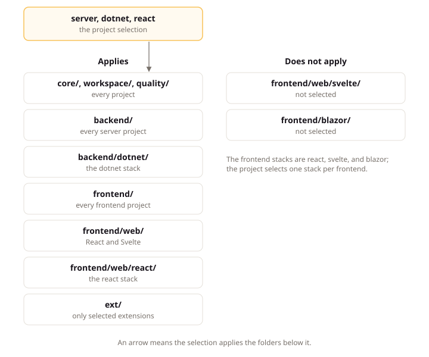

# Read the Standard

## Intent

A LiteSpec project chooses a selection (its size, shape, technology stacks, extensions, and the record layers it claims, recorded in the project file `.litespec/project.yaml`) and applies only the pages that selection names, because the standard is large and most of it never applies to one project. This page explains those choices, the folder arrangement they select from, the anatomy of a rules page, and the departures the standard provides for rules a project cannot follow.

## A Project's Selection

Your project does not adopt all of LiteSpec. It makes five choices in `.litespec/project.yaml`, and those choices decide which pages apply:

| Choice | Options | What it changes |
|:---|:---|:---|
| Size | `small` or `large` | Which record types the project keeps. A large project adds problems, features, journeys, scenarios, and an Acceptance test project. |
| Shape | `server` or `client-only` | Whether the project has its own backend. A client-only project has no API and applies only the backend principles about modeling the domain. |
| Stacks | One backend stack for a server project, and one stack per frontend | Which technology pages apply: `dotnet` for the backend, and `react`, `svelte`, `blazor`, or `android` for a frontend. |
| Extensions | Any of the listed extensions, or none | Extra capabilities with their own rules, such as audit, multitenancy, an outbox, or realtime updates. |
| Layers | `intent`, `behavior`, `implementation`, `proof` | Which record layers the project claims; [Adopt LiteSpec in Steps](adopting-litespec.md) walks through the claims. |

`litespec init --preset dotnet-react --size small` writes a first project file with a common selection. The [selection page](https://litespec.dev/select/) on the site does the same in a form and shows which pages apply.

The Claimwick example in `examples/claimwick/` declares its own selection in `.litespec/project.yaml`:

```yaml
size: large
shape: server
stacks:
  - dotnet
  - svelte
selectedExtensions: []
layers:
  intent: litespec
  behavior: litespec
  implementation: litespec
  proof: litespec
```

Read it as five answers: size large, shape server, the dotnet and svelte stacks, no extensions, and every record layer claimed under LiteSpec practice. That selection applies `backend/dotnet/` and `frontend/web/svelte/`, and it does not apply `frontend/web/react/` or `frontend/blazor/`. Behavior needs intent, and implementation and proof each need behavior, so a project claims the layers in that order.

The project file holds more than the selection: `paths` points at the documentation roots, `refusals` names the codes the two derived generic results carry, and `reviewedLiteSpecVersion` records the release the team adopted. The [project file page](../reference/project-file.md) lists every field.

## The Page Arrangement

The folder a page sits in decides who applies it:

```text
docs/
  core/  workspace/  quality/   every project
  backend/                      every project with a backend
    dotnet/                     projects that select the dotnet stack
  frontend/                     every project with a frontend
    patterns/                   UI patterns, for every frontend
    web/                        React and Svelte frontends
      react/  svelte/           each web stack
    blazor/                     Blazor frontends
    mobile/                     native mobile apps
      android/                  Android apps
  ext/                          only the extensions a project selects
```

Selecting a stack applies its folder and every folder above it. A React project applies `frontend/`, `frontend/web/`, and `frontend/web/react/`. The upper pages state the principle, such as "pages compose shared components only". The lower pages state how one stack does it, such as which React component library and which test runner.

The diagram below shows which folders a server project with the dotnet and react stacks applies, and which it does not.



The other folders explain rather than govern: `learn/` (these pages), `tutorial/`, `guide/`, `reference/`, and `tools/`, which describes each command.

## Page Sections and Provisions

A standards page carries the same sections every time:

- **Intent** introduces what the page covers, who applies it, and why it matters.
- **Concepts**, when present, explain the ideas the rules use.
- **Standards** are the rules you must follow.
- **Conventions** are defaults you may replace with your own.

Each rule is a heading followed by its ID line. Here is one from the [domain page](../backend/domain.md):

```markdown
### Keep Domain Independent of Outer Layers

**ID:** `litespec/backend/domain#keep-domain-independent-of-outer-layers`

**Strength:** required

**Statement:** The Domain code MUST reference only the language standard library and project-owned Domain types.

**Rationale:** Domain that references only the language standard library and its own types compiles and tests with no infrastructure at all.

**Reviewed for:** Domain code references the language standard library and project-owned Domain types, with no outer-layer reference.
```

Its **ID** line states `litespec/backend/domain#keep-domain-independent-of-outer-layers`: the page path, then the heading. Its **Strength** line states how binding it is: `required` binds every project it applies to, `default` binds unless the project records its own choice, and `advisory` is experience to apply with judgement. The **Statement** is the rule itself, one sentence with one capitalized word that sets its strength, as in internet standards: `MUST`, `MUST NOT`, `SHOULD`, `SHOULD NOT` or `MAY`. Everything under **Rationale** and **Example** explains it and adds no obligation. A page scope names its concern, and a provision states its own layer or trace only when it differs from its page.

Each page also states the scope its provisions apply to: the technology, the part of the system, and the kind of thing made. A provision narrower than its page names its scope, so an agent editing one file can ask which provisions govern it. The last line of each rule is its verification: `**Checked by:**` names the command that checks it, or `**Reviewed for:**` asks the question a reviewer answers. That shows whether a tool or a person catches a slip.

## Departures from the Rules

The standard expects departures and gives each one a home:

- **A departure record** sets a provision, page, or finding code aside for named records or paths, with its reason and, for a gap the team means to close, an expiry date and an exit. An agent follows the departure over the standard, and a covered finding reports as covered instead of blocking.
- **A project convention** is a standing rule every change follows, stated in the provision shape under `.litespec/governance/conventions/`. A decision chooses between options at one moment, and its `reopenedWhen` names what would reopen it; a convention states the rule that holds after, and its `Reviewed for` question names how a reviewer finds a breach. A convention states a judgment rule, never a list of words: product language lives in the glossary, where the checks read it. Code cites a convention in a `follows` or `proves` mark as `<project>/conventions#<slug>`. Its `Applies to` takes a path glob or the scope keys provisions use, such as `stack: dotnet; artifact: command-handler`, and `rules` reads only the conventions folder.
- **An extension** can replace a baseline rule when you select it. The outbox extension, for example, replaces the baseline rule for collecting domain events with its own.

When guidance overlaps, the most specific source wins: your departure or convention, then a selected extension, then the deeper page, then the shallower one. `litespec rules <path>` applies that order and shows the departure in place of the original.

The Claimwick example carries six departures under `.litespec/governance/departures/`. One of them, `examples/claimwick/.litespec/governance/departures/export-review-bypass/export-review-bypass.yaml`, reads:

```yaml
type: departure
id: departure/export-review-bypass
title: Export Review Bypass
covers:
  - litespec/backend/application#enforce-target-authorization-in-the-pipeline
subject:
  - use-case/spending.export-expenses
reason: The weekend export runs with no reviewer on shift.
consequences: Weekend exports run without a second pair of eyes until a reviewer returns.
expiresOn: 2027-01-01
exit: A reviewer approves weekend exports before they run.
```

Read it as one departure: it names the provision it covers, the records it sets aside, the reason, the consequences, and the date and exit by which the gap closes. An agent follows the departure over the standard until that date.

## UI Patterns

The pages in `frontend/patterns/` work differently. Each one covers a group of recurring interface questions, such as how a record's page header is laid out or how a list filters. Every pattern offers several options, each drawn as a wireframe, and names a default. Your project keeps a catalog of the option it chose for each pattern. The site draws every option on the pattern's page, so you can choose by looking.

## Next

[Work with Agents](working-with-agents.md) explains how an agent uses the standard and the records together.
