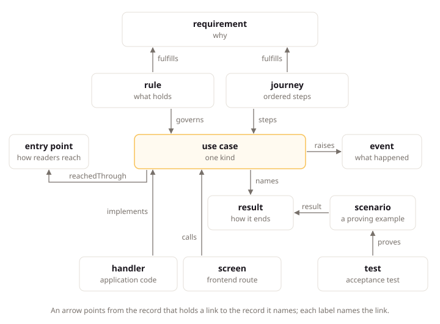

# Records and the Project Model

## Intent

Every LiteSpec project writes its intent (what to build, and why) as small records across four layers, and the model builder joins those records to the code and tests that carry them. This page explains the layers, what those records are, where they live, and what the model builder works out from them. Team members and agents read it before they write their first record, so each piece of intent lands in the right type and home from the start.

## Small Records of Intent

A record is the smallest piece of intent the team can state on its own: one requirement, one rule, one use case, one decision. Each record is a short YAML record file, or an entry in one, holding its facts as fields. An optional Markdown explanation file beside the record file explains it for people and agents. People read the record with its explanation, and tools read the fields.

Keeping intent in small records instead of long documents gives three results:

- Each piece stands alone, so the team always knows what is stated and what is missing.
- Records point at each other by ID, so a reader follows a use case to the requirement it fulfills and the decision behind it.
- Tools check records, so a missing result or a broken link fails a build instead of surprising a reader.

## The Four Layers

Every record answers one layer's question, and each layer is written from the layer above it:

| Layer | Question | Records |
|:--|:--|:--|
| Intent | Why build it, and what do we promise? | Product, goal, problem, feature, requirement, constraint, decision, research, module, journey, actor, role, term |
| Behavior | How does the system behave to keep the promises? | Aggregate, rule, event, integration event, use case, result, scenario, reaction, job, notification, setting, permission, entry point, external system, term |
| Implementation | How is it built? | Code, technical decisions, runbooks, the API contract, guides |
| Proof | How do we know it holds? | Tests, check results, computed completion, the rendered book |

Governance records attach to any layer: an exception of kind `departure` replaces one provision for the project, and an exception of kind `gap` records one check staying red until a date. Each carries a reason and an expiry date.

Three translation rules join the layers. **Specify** turns Intent into Behavior: it adds states, invariants, refusals, consistency, data classes with their erasure positions, freshness, and access with tenant scope, and it never decides a price, fee, rate, term, market, payer, personal-data retention period, observable freshness, or any default that differs by tenant, market, or date. When Behavior needs a value Intent does not state, the agent takes it to the owner or the backlog, and never invents it. **Implement** turns Behavior into code: it adds the code shapes the stack pages fix, and it adds no outcome no result declares, no edge no record declares, no write outside `changes`, and no access wider than the grant. **Verify** turns code into Proof: one test proves each scenario through the public boundary.

## What Belongs in Intent

Every record is about the software. It states what the application does, holds, refuses at runtime, or runs on, and it translates into code, results, tests, or infrastructure. Running the company stays out: prices as an offer, markets, sales, hiring, launch dates, and founder risks enter only as a constraint or as dated research.

| Type | Belongs when it is | Out when it is |
|:---|:---|:---|
| Goal | A software outcome, such as nights running without oversell | A business outcome, such as retention or revenue |
| Problem | A user pain the software answers | A sales or market problem |
| Feature | A capability the software has | A marketing tactic or a launch plan |
| Requirement | A commitment Behavior fulfills | (always software when it reaches Behavior) |
| Constraint | A law, a provider, or a limit that binds the software | A company duty with no software effect |
| Research | Evidence a software record cites | Market sizing or viability |
| Module | A product area of the bounded context | A company function |

The check is reachability: a goal reaches a journey or a quality requirement, a problem reaches a feature or requirement that addresses it, a feature or requirement reaches a use case, journey, or quality scenario in Behavior, a constraint is answered by a requirement, research is cited by a record that reaches Behavior, and a decision decides a record that reaches Behavior. A record that reaches no Behavior is either unfinished work, which belongs on the backlog, or not software. The check reports it locally and blocks it in the pull-request check.

## Record Types and Their Homes

The record types follow the questions a team asks, from why down to how:

| Question | Record types |
|:---|:---|
| Why does this product exist, and within which outside rules? | Product, goal, constraint, research, decision, module, requirement |
| What does it offer, and for which pain? | Problem, feature |
| Who acts, and what may they do? | Actor, role, permission |
| How is it reached, and what outside systems does it meet? | Journey, entry point, external system |
| How does the business behave? | Aggregate, rule, event, integration event, use case, result, scenario, reaction, job, notification, setting |
| How is it run? | Runbook, retention schedule |
| How is it built and spoken about? | Exception, term |

A small project keeps the rows the [model page](../core/model.md) marks small. A large project also keeps problems, features, journeys, and scenarios, which tie the product story to proven examples. Constraints and research switch on separately, and runbooks join when the product first goes into production.

Each type has one home in the repository. Intent reads module, then feature, then requirement: features with their requirements live under `.litespec/intent/modules/<module>/features/`, beside the module's own goals, problems, constraints, decisions, and research, while product-level records live directly under `.litespec/intent/`. Behavior reads module, then aggregate, then use case: a module's aggregates and use cases live under `.litespec/behavior/modules/<module>/`, its reactions, jobs, notifications, settings, permissions, and integration events in matching subfolders, cross-aggregate rules under `.litespec/behavior/rules/`, entry points with their screens under `.litespec/behavior/entry-points/<entry-point>/`, and access roles beside actors in Intent. Exceptions live under `.litespec/governance/exceptions/`, or under `.litespec/governance/modules/<module>/exceptions/` when every record they set aside sits in one module. The [model page](../core/model.md) lists every home, and the `templates/consumer/` folder of the LiteSpec release holds a starting file for each type.

## How to Write a Feature Under a Module

A feature lives in its module's folder and holds its requirements as entries. The Claimwick feature that carries the receipt rule lives at `.litespec/intent/modules/spending/features/approval.yaml`:

```yaml
type: feature
id: feature/spending.approval
title: Expense Approval
summary: Employees submit expenses and approvers decide them.
solves:
  - problem/waiting-for-reimbursement
records:
  - type: requirement
    id: requirement/approval.receipt-over-threshold
    title: Receipt over Threshold
    statement: An expense above the receipt threshold carries a receipt.
```

Read it as one capability with its promises inside: the feature names the problem it solves, and each requirement entry states one commitment Behavior fulfills. A requirement's identifier names its feature, so every citation changes in the same change when a requirement moves to another feature.

## Links Between Records

Records join through fields on the record that points. In the Claimwick example, access runs through three records and one declared grant: the actor holds a role, the role allows permissions, and the use case declares its access with one of them:

```yaml
holds:
  - role: role/employee
    scope: self
allows:
  - permission/submit-expense
  - permission/list-expenses
access:
  grant: permission/submit-expense
  tenant: own
```

Read it as a chain: `actor/employee` holds `role/employee`, the role allows `permission/submit-expense` among others, and `use-case/spending.submit-expense` declares that permission as its grant and a tenant scope of its own. Access reads as one chain from actor to use case, exactly as the [access page](../core/access.md) states.

Behavior also connects upward and sideways. A use case serves journey steps and fulfills requirements, so every use case answers Intent. A reaction names the events it answers in `triggeredBy`, a job names its `kind` and `schedule`, and each names the use cases it runs. A use case names every edge it causes in `effects`: `runs` for a command, `sends` for a notification, `emits` for an integration event, and `calls` for an external-system operation, each with its timing. An undeclared edge is the defect the checks report.

## The Folder Is the Parent

The folder structure is authoritative and fully validated, in every layer. A record's folder is its parent: the product, a module, an aggregate, or an entry point. Product, module, aggregate, and entry point are the only nodes a folder stands for; every other folder name comes from a closed set of type folders per layer, and anything else is a blocking finding.

```text
.litespec/intent/
  product.yaml
  goals/  problems/  constraints/  decisions/  research/  actors/  roles/  journeys/
  modules/
    spending/
      module.yaml
      goals/  problems/  constraints/  decisions/  research/
      features/
        approval.yaml            the feature with its requirements as entries
.litespec/behavior/
  modules/
    spending/
      expenses/                  aggregate
        submit-expense.yaml      use case
```

Product level holds the product, actors, roles, and journeys; journeys cross modules through their steps. Module level holds features with their requirements. Goals, problems, constraints, decisions, and research sit at either level, and the folder says which. A record under a module is linked from another module only along a declared module dependency or through an integration event; a link from another layer down to the next may cross modules, because that is how one capability spans modules.

Each record keeps two identifiers. The identifier is short and unique in the product, and every link uses it: `use-case/spending.submit-expense`. The qualified identifier is computed from the identifier plus the placement, never written, and shown in the book and the CLI: `spending/expenses/use-case/submit-expense`. A record that moves to another module changes the module segment of its identifier and every citation in the same change, which `litespec rename` rewrites together.

## Changing a Record When Git Is the Record

Git is the decision record. A record present in git is decided, and the pull request that changes it is its review. To change a record, edit it and open a pull request; to remove one, delete it. Who changed what and when is `git log` and `git blame`.

A branch may be incomplete; what merges is complete. The checks report reachability locally and block it in the pull-request check, so unfinished work can sit on a branch but cannot merge. A record that must stay unreached past a merge carries an exception with `expiresOn`, which parks reachability for that record until it expires.

## Completion Is Computed

You never write whether a use case is implemented or verified. The model builder computes both, and the book leads with them.

`litespec model check` reads the records and follows the marks by which code and tests point up to them: the mark each code element carries and the proves mark each test carries. For each use case it finds:

- The handler, reaction, or job class that **implements** it, from its mark.
- The screens that **call** it, from the frontend's generated API client.
- The tests that **prove** each scenario, from the tests that claim them and the latest test run.

A use case is implemented when its handler exists, and verified when a passing test proves every scenario. The builder recomputes these links on every run, so they cannot go stale the way a hand-kept traceability table does.

The diagram below shows the main record types around one use case, the links the records hold, and the three links the builder computes.



## Uses of the Model

- **Checks.** `litespec model check` reports each gap as a finding with its level: level G checks read records only and always block, level S checks read code through a stack reader and block where that reader is qualified, and level A checks advise without blocking. A use case with no handler, a refusal the code never raises, a link to a missing record, or an exception past its expiry date each becomes a finding.
- **Answers.** `litespec model query <id>` prints one record with every link into and out of it. Agents use it to load exactly the context a task needs. It accepts the identifier or the qualified identifier.
- **Rules.** `litespec rules <path>` lists the provisions that apply to a file, grouped by strength, with the project's conventions and departures merged in. Agents run it before editing.
- **Scaffolding.** `litespec new` puts a record in its one legal folder with a correct identifier, and `litespec rename` rewrites every citation when an identifier changes. `litespec model format` rewrites record files into canonical form.
- **Generated sections.** `litespec model render` fills the marked regions of your pages from the model: the alert inventory, the runbook index, and the operations log.
- **The project book.** `litespec book` turns the model into a browsable site of your own project: the outline, completion, the folder tree, and the access chains, with hash routes per record and search.

## Next Steps

[Reading Tracks](reading-tracks.md) states which records to read in which order: why before how, one journey end to end, and one module end to end.
