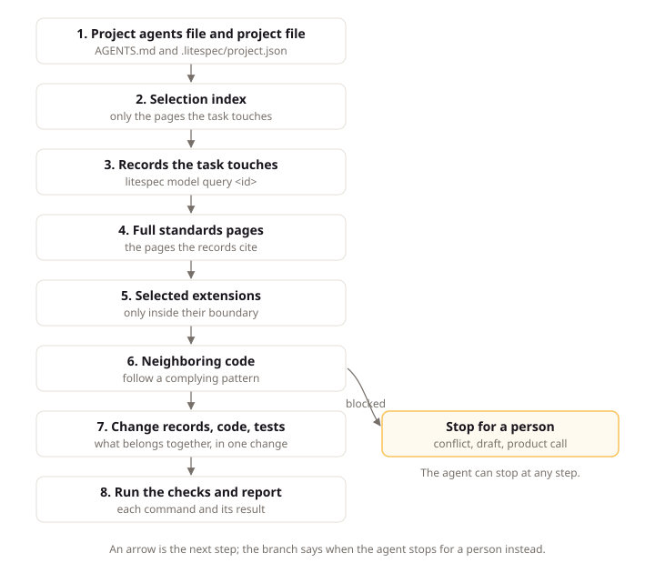

# Work with Agents

## Intent

An AI coding agent (software that reads task context, changes files, and runs checks) does its best work when the rules are written down and the checks run before review. This page explains how an agent finds the LiteSpec rules for your project, the order it follows on a task, and which decisions stay with you. Team members read it when they first hand work to an agent, so the agent starts from your records instead of its own habits.

## Rules, Records, and Checks

Without LiteSpec, an agent decides architecture, naming, and testing from its training and from whatever files it happens to open. With LiteSpec, those choices are already made and written down, so the agent spends its effort on the work you asked for.

An agent gets three things:

- **Rules it can cite.** Every provision has an ID and a strength, so the agent cites exactly which rule a change follows; [Read the Standard](reading-the-standard.md#page-sections-and-provisions) shows the anatomy.
- **Records it can trust.** The records in git say what to build. The specification is closed: the agent builds what they state and nothing more.
- **Checks it can run.** `dotnet litespec model check` and the CI gates tell the agent whether its change holds before you review it.

## Rule Sources

An agent finds the rules in two places: the installed tool and the published site.

### The Installed Tool

The project installs the `litespec` command line at the adopted release, as a local .NET tool or as the standalone binary. Either carries its whole release, manifest, schemas, docs, and templates, so every check reads the same contract the team pinned. The project's `AGENTS.md` carries a generated agent protocol region that names the release and its selection, and the agent reads only the pages a task touches.

Before editing a file, the agent asks which provisions govern it:

```bash
dotnet litespec rules apps/api/src/Claimwick.Modules/Spending/Expenses/UseCases/SubmitExpense/SubmitExpenseCommandHandler.cs
```

The command lists the provisions grouped by strength, as one-line statements, with the project's conventions and departures merged in. When a statement is not enough, `--full` adds rationale and example.

### The Published Site

An agent that can fetch URLs reads the standard from litespec.dev. The [selection page](https://litespec.dev/6.0.0/select/) renders the same agent protocol that `litespec init` writes into a new project's `AGENTS.md`, filled for the chosen selection:

```markdown
<!-- generated:agent-protocol -->
When this file disagrees with `dotnet litespec rules`, `dotnet litespec model query` or a record, the tool output and the record win; this file only points to them.

This project follows LiteSpec 6.0.0: size small, shape server, stacks dotnet, react, extensions none.
Layers: intent and behavior: litespec, implementation and proof: litespec.
Before a task, read https://litespec.dev/6.0.0/select/server.dotnet.react/llms.txt and fetch only the pages the task touches.
...
<!-- /generated:agent-protocol -->
```

The region opens with a precedence sentence: when the file disagrees with tool output or a record, the tool output and the record win. `litespec model render` rewrites the region from the project's release and selection, and `litespec model check` reports drift when a hand edit changed it.

That index lists every page the selection applies, with a one-line description and a raw Markdown link for each. An agent reads the index, then fetches the few pages a task needs. Every page also exists as plain Markdown at the same path with an `.md` extension, such as `https://litespec.dev/6.0.0/backend/domain.md`.

## The LiteSpec Skill

A LiteSpec skill teaches Claude Code and OpenCode the LiteSpec procedure: read the protocol region and the project file, query the model, run `rules` for each file, and report with the checks.

`litespec skill add` installs the skill from the carried release, at project scope or with `--global` at global scope. `litespec init --skill <agent>` installs it during setup. Without `--agent` it installs for `agents` and `claude`, which together reach both tools.

`litespec model render` rewrites project-scope copies, and `litespec model check` reports `skill-drift` when a project copy differs from what the carried release generates. Global copies live outside the project and stay outside the check.

## Entry Files per Agent

Each agent reads its own entry file. The table names the file and how to bridge it to the shared `AGENTS.md` protocol.

| Agent | Reads | Bridge |
|:---|:---|:---|
| Claude Code | `CLAUDE.md`, else the nearest `AGENTS.md` | Import the protocol with `@AGENTS.md` in `CLAUDE.md` |
| OpenCode | The nearest `AGENTS.md` | None; it reads the file directly |
| Codex | The nearest `AGENTS.md` | None; it reads the file directly |
| Copilot | The nearest `AGENTS.md` | None; it reads the file directly |
| Cursor | The nearest `AGENTS.md` | None; it reads the file directly |
| Gemini CLI | `GEMINI.md` | Point `context.fileName` at `AGENTS.md` |

`litespec init` prints a line when a `CLAUDE.md` does not import `AGENTS.md`, and `litespec model check` reports `agent-protocol-unreached` as advisory for the same gap.

## The Agent Task Sequence

Adding new intent to a running project follows the one sequence under [New Intent in a Running Project](../core/agent.md#new-intent-in-a-running-project) on the agent page. This page states no second order.

For any task, the agent reads the project's `AGENTS.md` and `.litespec/project.yaml`, queries the model for the records the task touches, runs `litespec rules <path>` for the files it will edit, reads the pages `rules` cites, and looks at neighboring code after the standards. Before editing, the agent also reads `git status`, so unrelated work in the tree stays untouched. When the change touches an extension's boundary, the agent reads the selected extension before it edits.

The diagram below shows that order, and where the agent stops for a person instead of deciding alone.



For example, an agent asked to change how expense reimbursement works starts with one query:

```bash
dotnet litespec model query use-case/spending.submit-expense
```

The answer prints the record with its links in both directions. The agent reads the requirement, the rule, and the results the use case touches, then the standards pages they cite, before it opens the handler. The agent protocol region in the project's `AGENTS.md`, shown above, tells the agent where the selection index lives.

When two rules conflict and nothing decides between them, the agent stops and asks, quoting both rule IDs.

## Agent Decisions and the Closed Specification

An agent makes the decisions the standard has already made: where a type goes, how a lifecycle is modeled, how a refusal is reported, and which tests to write. It does not decide product policy, legal questions, or money. When the specification does not state what the work needs, the agent takes the gap to the owner or the backlog instead of answering it, and it finishes by answering each judgment provision `rules --since <base>` lists in its report.

The agent protects proofs. It does not delete, skip, or weaken a test that proves a scenario, and it does not change expected values unless the scenario changed in the same change. When a proving test fails or looks wrong, the agent stops and reports the mismatch instead of fitting the test to the code.

UI design works the same way. For each recurring interface question, LiteSpec offers drawn options and a Default. An agent builds the Default with your own components and style and records it with `source: recommended`. It waits for the owner only when the route departs from the Default or no Default exists; in that case it shows the options on the pattern's page on the LiteSpec site and recommends one. If it sees a better option while working, it finishes on the recorded option and proposes the idea in its report, instead of changing the decision.

## Next Steps

[Adopt LiteSpec](adopting-litespec.md) walks through what changes for a team that starts using it.
